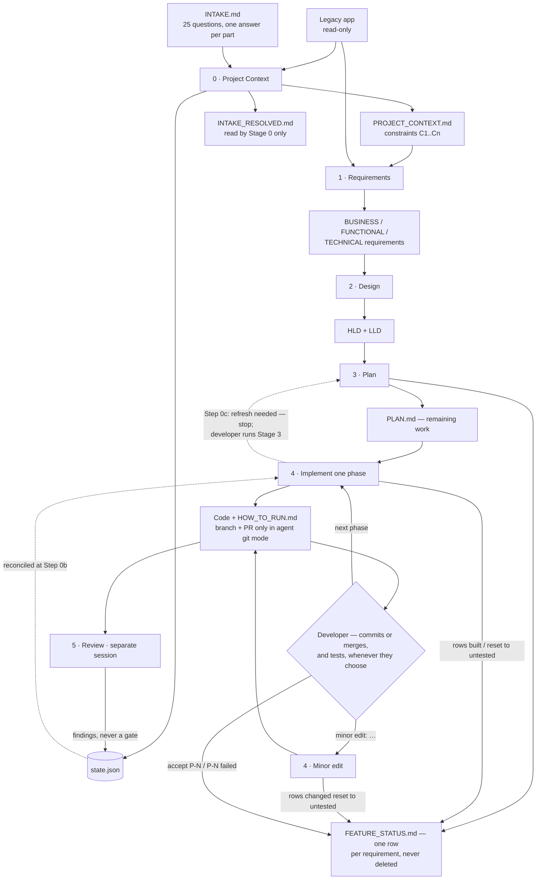
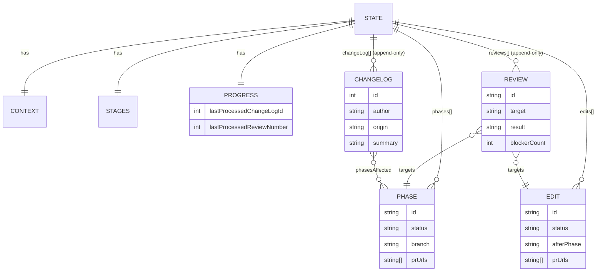
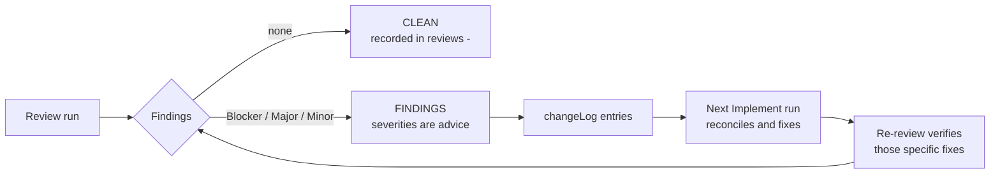

# Design — Modernization Harness

*How the harness is built, as currently implemented. Pairs with [REQUIREMENTS.md](REQUIREMENTS.md).*

---

## 1. Design in one paragraph

The harness is **thirteen Markdown files**. Seven are stage instructions, invoked one per agent
session — Stage 4 has two, one for phases and one for minor edits (DD-22); one is a git supplement
Stage 4 loads only when the agent runs git (DD-21); two are templates the developer copies into
their project; three are the guides. All coordination
between sessions happens through **two artifacts on disk** — human-readable Markdown documents
and one machine-readable `state.json`. Nothing is held in an agent's memory between runs,
because there is no "between runs": each stage session starts cold, reads state, does one unit
of work, writes state, and stops.

## 2. Components

| File | Kind | Responsibility |
|---|---|---|
| `AGENTS_TEMPLATE.md` | template → `AGENTS.md` | Invariants, authority ladder, and the protocol for recording what the developer tells you. Loads in **every** session |
| `0_INTAKE_TEMPLATE.md` | template → `INTAKE.md` | The 25 numbered questions, split into single-answer parts (`12a`, `12b`, …; tick boxes where the answer is a choice), their defaults, and which parts are load-bearing — 6 topics, plus Q8 when the schema is new. API description and hand-testing tools, connection identities (database included), role mapping, test sign-in, config/secrets delivery, and supplied API descriptions/collections each have their own part (R2.6) |
| `0_PROJECT_CONTEXT_INSTRUCTIONS.md` | stage | Resolve intake → `PROJECT_CONTEXT.md` + `INTAKE_RESOLVED.md` (its own record, DD-19) + initialize `state.json` |
| `1_REQUIREMENTS_EXTRACTION_INSTRUCTIONS.md` | stage | Legacy code → business / functional / technical requirements |
| `2_DESIGN_INSTRUCTIONS.md` | stage | Requirements → HLD + LLD |
| `3_PLAN_INSTRUCTIONS.md` | stage | Design → phased plan + `phases[]`; the only stage that changes the forward plan (refresh, DD-23) |
| `4_PHASE_IMPLEMENTATION_INSTRUCTIONS.md` | stage | Build one planned phase; stop when the plan needs a refresh |
| `4_MINOR_EDIT_INSTRUCTIONS.md` | stage | Make one minor edit — a change that touches no contract (DD-22) |
| `GIT_DISCIPLINE.md` | supplement | Branch, commit, PR and merge rules; loaded by Stage 4 only when `context.repo.git` is `agent` (DD-21) |
| `5_REVIEW_INSTRUCTIONS.md` | stage | Independent audit; findings back into `state.json` |
| `tools/state.py` | tool | Reads and writes `state.json` for every stage after 0 (DD-18) |
| `DEVELOPER_GUIDE.md` / `README.md` / `USE_CASES.md` | guide | The reasoning / the five-minute start / the situations you'll hit, by example |

## 3. Pipeline



**Nothing on this diagram blocks.** The developer's testing and the Review stage both feed the
loop without holding it: the only gate is a phase's own falsifiable exit criteria.

Stages 0–2 run once each (and on rerun). Stages 3–4–5 are the loop.

## 4. Key design decisions

| # | Decision | Why |
|---|---|---|
| **DD-1** | **Constraints carry per-stage obligations**, defined once in `PROJECT_CONTEXT §4` | Stage files hold zero project-specific rules, so a new constraint needs no edit to any stage file. This is what makes the harness stack-agnostic (R1) |
| **DD-2** | **Split state from content**: `state.json` for machine state, Markdown for prose | Markdown status tables were unmergeable and drifted. JSON gives lineage, mechanical reconciliation, and diffable history (R7) |
| **DD-3** | **High-water mark** rather than "diff everything" | A run must distinguish new change-log entries from ones it already applied, without re-reading history each time (R7.3) |
| **DD-4** | **One gate: falsifiable exit criteria.** Status moves `pending → in progress → done`, forward only | The acceptance gate cost the developer an hour of testing before any further building, so it forced a choice between working and claiming something untrue. Removing it leaves the self-check — which is meaningful only because it can fail (R4) |
| **DD-5** | **Permanent phase IDs; order lives in the plan** | PRs, branches, and reviews keep meaning what they said, even after re-slicing (R5.4) |
| **DD-6** | **Retrofit phases, never reopened `done` ones** | What is built is built: a delivered phase's ID, scope and place in history stay as written, and the change is new work that supersedes its behavior (R6.3) |
| **DD-7** | **Contract changes are a three-prompt flow** (rerun Stage 2, run Stage 3 refresh, then the next phase) | The pause is the point — it's where the developer catches a design being amended into something they didn't intend. The middle prompt exists because Stage 3 alone changes the forward plan (DD-23); it can run on a cheaper model |
| **DD-8** | **`AGENTS.md` always loaded** | Stage rules only bind when a stage is invoked; most drift happens in ordinary chat |
| **DD-9** | **`HOW_TO_RUN.md` (how to run it) + `FEATURE_STATUS.md` (what is built and tested)** | Per-phase test docs went stale, and one regenerated file duplicated the plan's own test guides. Splitting *how to run* from *what to check* leaves each written once: the run doc changes only when running changes, and each feature's check sits beside the column the developer ticks (R10) |
| **DD-13** | **Testing is tracked per feature, not per phase** | A phase is a batch of work; a later phase can change what an earlier one delivered, and a phase-level mark cannot express that. A feature row can — it gains the new phase and resets to `untested` (R4.3, UL-5) |
| **DD-14** | **Branch from the currently checked-out branch, PR back at it, and never merge unasked** *(agent git mode, DD-21)* | The developer's git state becomes the instruction, so nothing needs configuring — and because the next phase starts from where the last one's code already is, *no merge is required for the pipeline to work*. That removes the merge trigger, the permission question, `mergePolicy` and `mergedUtc` in one go. The agent still merges on an explicit "merge P-3", because refusing a direct instruction about the developer's own repo buys nothing (R11.2). Under `developer` the agent creates no branch and no PR; the developer commits each run's work before the next |
| **DD-17** | **Before branching, detect a branch that is already merged or gone from the remote, and propose the alternative** *(agent git mode)* | Reading the current branch makes the *unusual* path (never merging) frictionless and the *common* one broken: the developer merges on the host, the host deletes the branch, their checkout stays on it, and every content check still passes because the code is present. Without this the next phase silently targets a branch that no longer exists (R11.5). Under `developer` the agent never branches, so there is nothing to check |
| **DD-15** | **Git is the truth; `state.json` is a cache** — presence checked by content, never by branch-merge status | The developer may merge or edit outside the harness and should not have to report it; squash and rebase merges make branch-based checks answer "not merged" when every line is present. Nothing records merges at all, so there is nothing to keep in step (R11.3). Under `developer` the same content check runs on the working tree: the files and symbols the predecessor delivered must exist there |
| **DD-16** | **`prTarget` is kept as a human note that no rule reads** | Where work lands is decided by which branch the developer stands on, not by a field. Keeping the field documents intent; reading it would resurrect a setting the branching rule replaced. Under `developer` no PR exists, so it only tells the developer where their own commits are headed |
| **DD-10** | **Plan defaults to "no change"** | Churn burns the developer's review attention and destabilizes what they thought was coming next. Applied by Stage 3 on every refresh, and by Stage 4 when it checks for refresh triggers (DD-23) |
| **DD-11** | **Review is a separate session, read-only on code, and never blocks** | An agent cannot audit its own work; read-only keeps the verdict honest. The gate it used to hold only ever fired for a developer who chose to run it, and its findings already survive through the change log — so it reports and advises instead (R8) |
| **DD-12** | **Documents amended in place; git is the history** | No `_v2` filenames; Revision History rows plus commits give lineage. Under `developer` git mode those commits are the developer's |
| **DD-21** | **Who runs git is a project setting: `context.repo.git` = `agent` \| `developer`, default `agent`.** The branch, commit, PR and merge rules live in `GIT_DISCIPLINE.md`, which Stage 4 loads only under `agent`. Under `developer` the agent runs **no git command that changes the repository** (no branch, checkout, commit, push, merge or PR); read-only commands (`status`, `diff`, `log`, `show`) are allowed. `branch` stays `null`, `prUrls` `[]`; the hand-off lists the changed files and a suggested commit message, and the changed files go in the entry's `notes`; the developer commits after each run, before the next | Some projects cannot let the agent run git (the git tool hangs), yet every phase run paid ~2,400 tokens for git rules it never used. A setting keeps git for projects that can use it; deleting the rules was rejected because it removes a working feature. Read-only git is kept because it changes nothing and lets reconciliation diff the documents (R12) |
| **DD-22** | **Stage 4 is two files: `4_PHASE_IMPLEMENTATION_INSTRUCTIONS.md` (planned phases) and `4_MINOR_EDIT_INSTRUCTIONS.md` (minor edits).** The developer starts an edit with "minor edit: …". A phase run that receives a request which is neither a planned phase nor contract-touching **stops and asks the developer to start a minor-edit run** — no handover inside the session. An edit run that finds a planned phase or a contract change stops and routes it back. An edit run does not reconcile: the next phase run folds in everything | A minor edit paid for the whole phase procedure. Two files let each run load only what it uses. No automatic handover keeps each run to one instruction file and the developer aware of which kind of run is happening (R6.4) |
| **DD-23** | **Stage 3 is the only stage that changes the forward plan.** Stage 4 checks the refresh triggers at Step 0c and, if one applies and is not handled, **stops**: "Run Stage 3 (refresh) first: <reason>". Triggers are `changeLog` entries whose summary starts `For Stage 3:` — written by a Stage 0 rerun that binds the plan, every Stage 1/2 rerun, and Stage 4 — plus a developer request. A trigger is handled once a `PLAN §3 Plan Revision History` row names its `changeLog` id (ids are unique; revision tables hold dates without times, so dates cannot be matched); every refresh names all unnamed ones. Stage 4 runs this check before Step 0b writes anything. Stage 4 still edits the **current** phase's tasks, test guide and exit criteria when reconciliation needs it; changes for future phases only go to `changeLog[]`. An approved mid-phase split trims the current phase and parks the moved work as `sizeReport.pushedLater[]` with `toPhase: null` and its ledger rows `unscheduled`; the next Stage 3 refresh schedules it | Re-planning text in Stage 4 was loaded on every phase run but used rarely, and two stages editing the same plan split its ownership. One owner keeps the rules in one place. The cost is one extra prompt per design change (DD-7) (R5) |
| **DD-18** | **`state.json` is read and written through `tools/state.py`, not by the agent directly** | `changeLog[]` and `reviews[]` only grow, so whole-file reads cost more every run; the tool returns the slice asked for (`summary`, `get`, `new`). It also turns the mechanical rules — forward-only status, append-only history, id allocation, numeric `R-<n>` comparison — from prompt text into refusals. Stdlib Python, one file; Stage 0 still writes the initial file by hand, and hand edits under the same rules remain the fallback (R7) |
| **DD-19** | **The resolved intake lives in its own file, `INTAKE_RESOLVED.md`, which only Stage 0 reads** — `PROJECT_CONTEXT §5` is a one-line pointer to it | The answer-by-answer ledger (one row per intake part, ~2–3k tokens) is Stage 0's record and its rerun diff baseline; no later stage uses it, yet every later stage paid for it by opening the context file. The safeguard is a Stage 0 rule: any defaulted or inferred answer that shapes a later stage is also stated in `PROJECT_CONTEXT.md` (its home section, a constraint, or §7), so nothing a later stage needs is only in the ledger. §5 keeps its number so §6–§10 do not shift (R2.3, R2.7) |
| **DD-20** | **Constraint obligations are stored only in `PROJECT_CONTEXT §4`; `state.json` holds no copy of the constraints** | A second copy in `context.constraints` was read by four stages on top of §4, and nothing checked the two stayed equal. DD-1 already makes §4 their home, and DD-2 keeps prose out of `state.json`. Keeping only ids or titles in state was rejected: no stage would read them, and they would be one more copy to drift (R1.3) |

## 5. Data model — `state.json`



`state.json` holds **machine facts only**. The constraints are not in it: they and their
per-stage obligations live only in `PROJECT_CONTEXT §4` (DD-1, DD-20). What a human has tested is not in it: that lives in
`FEATURE_STATUS.md`, keyed by requirement ID, because a later phase can change what an earlier
one delivered (DD-13). A review has no status to set on its target (DD-11), so there is no
`reviewStatus` anywhere and no `wholeBuild` record.

Rules that hold the model together:

- **Append-only:** `changeLog[]`, `reviews[]`. Correct by superseding, never rewriting.
  `edits[]` entries are never deleted or renumbered, but their lifecycle fields are updated in
  place, like `phases[]`.
- **ID allocation:** `changeLog.id` = max + 1; `E-<n>` and `R-<n>` use the next unused *n* for
  their own array. IDs are never reused.
- **`progress` is numeric** — `R-10` sorts before `R-2` as a string, which would silently skip
  reviews.
- **`context.repo` / `context.deployment`** are decided *only* in Stage 0, which is also the
  only stage that writes them. Where `frontendRoot` / `backendRoot` were left null, Stage 2
  settles the tree in **LLD §3a** rather than in state; nothing downstream may invent a layout.
- **`context.repo.git`** — `agent` | `developer` (intake Q16g, default `agent`) decides whether
  Stage 4 loads `GIT_DISCIPLINE.md` (DD-21). Under `developer`, `branch` stays `null` and
  `prUrls` `[]` on every phase and edit.
- **`sizeReport.pushedLater[].toPhase`** may be `null`: work a mid-phase split moved out,
  waiting for Stage 3 to schedule it (DD-23).

## 6. Control flow of a build run (Stage 4)

```mermaid
sequenceDiagram
    participant D as Developer
    participant A as Build agent
    participant S as state.json
    participant F as FEATURE_STATUS.md
    participant G as Git

    D->>A: "Next phase."
    A->>S: read phases[], changeLog[] > mark, reviews[] > mark
    A->>G: check by content for predecessor's work (agent mode: on the CURRENT branch)
    A-->>D: "Building P-3 on <current>. Contains P-2's work."
    A->>A: 0a classify — phase / contract change / minor edit
    A->>A: 0b reconcile changes + review findings since last run
    A->>A: 0c refresh needed? (default: unchanged)
    opt unhandled refresh trigger
        A-->>D: "Run Stage 3 (refresh) first: <reason>" — stop
    end
    A->>G: agent mode: branch from current, task-sized commits
    A->>A: run exit criteria (the only gate)
    A->>S: status=done, branch, prUrls, advance high-water mark
    A->>F: rows built in P-3; rows P-3 changed reset to untested
    alt agent git mode
        A->>G: push + open PR targeting the branch it came from
        A-->>D: report + 2 counts + PR link (+ other open PRs)
    else developer git mode
        A-->>D: report + 2 counts + changed files + suggested commit message
    end
    Note over D,G: the developer merges (agent mode) or commits (developer mode) — commits before the next run
    Note over D,F: testing happens whenever — "accept P-3" ticks rows, gates nothing
```

A **minor-edit run** (`4_MINOR_EDIT_INSTRUCTIONS.md`) is the same shape without reconciliation,
Step 0c or phase status: authority test → change → verify → `edits[]` entry → report → stop.

## 7. Review, and why nothing blocks



The gate this stage used to hold only ever fired for a developer who **chose** to run a review —
it punished the careful and protected nobody else. Its findings already survived without it, via
the change log and the `lastProcessedReviewNumber` high-water mark; the gate only changed *when*
they were fixed, not *whether*. So Review states plainly what it would not build on, and the
developer decides.

That leaves the pipeline with **no hard gate but a phase's own exit criteria**. The trade is
recorded in §10.

## 8. Conflict resolution

A single ladder, stated in `AGENTS.md` and repeated by reference only:

**constraint (`PROJECT_CONTEXT §4`) → plan → LLD → HLD → requirements → rest of context**

A constraint always wins; if honoring it breaks a design contract, that is a blocker for a
human, not a choice the agent makes. Material conflicts are reported, not resolved.

## 9. Traceability

| Requirement | Realized by |
|---|---|
| R1 stack-agnostic | DD-1 constraints + obligations, stored once in `PROJECT_CONTEXT §4` (DD-20); `context.currentStack` / `targetStack` |
| R2 load-bearing questions | `0_INTAKE_TEMPLATE.md` defaults / hard-stops; Stage 0 Step 1 (incl. its cross-checks); `INTAKE_RESOLVED.md` (DD-19); eval check D5 holds the template's shape |
| R3 document order | Stage files 0–5; `stages.<name>.status` |
| R4 one gate + testing record | Plan §The Only Gate; `FEATURE_STATUS.md`; `AGENTS.md` §Recording What the Developer Tells You |
| R5 rolling plan | Plan §Refreshing the Plan (sole owner, DD-23); Stage 4 Step 0c detects triggers and stops; `FEATURE_STATUS.md` |
| R6 mid-build change | Stage 4 §0a, §When a Change Touches a Contract; `4_MINOR_EDIT_INSTRUCTIONS.md` (DD-22); retrofit phases planned by Stage 3 |
| R7 machine state | `state.json` schema (Stage 0 Output 2); `progress` high-water mark |
| R8 review | Stage 5 §Outcome; `reviews[]`; findings reconciled at Stage 4 Step 0b |
| R9 governance | `AGENTS.md` invariants + authority ladder |
| R10 testability | Stage 4 Step 2.3–2.4 (`FEATURE_STATUS.md`, `HOW_TO_RUN.md`); plan test guides |
| R11 git | `GIT_DISCIPLINE.md` §For every unit of work, §Starting From the Right Base (incl. the spent-branch check) — loaded only in agent git mode |
| R12 git mode | `context.repo.git` (Stage 0, intake Q16g); `AGENTS.md §Git mode`; Stage 4 files load `GIT_DISCIPLINE.md` only under `agent` (DD-21) |

## 10. Known trade-offs

- **No hard gates remain.** Nothing prevents a bad build from growing except the developer
  reading the reports — the two counts at every hand-off, and Stage 5 when they run it.
  Defensible for a modernization build with one user and nothing deployed; it would not be for
  a team shipping to production, and whoever inherits this harness should know that is the
  trade that was made.
- **Untested code reaches a branch only when the developer merges it there.** The agent never
  merges, so nothing lands on `main` without a human clicking Merge. The cost is the mirror
  image: if they never merge, phases stack as a chain of open PRs, landed later **oldest first**
  (each merge makes the host re-point the PR above it at the base branch). The hand-off report
  names the other open PRs so the height of that stack is at least visible — there is no setting
  that controls this, and no agent-side protection to rely on.
- **Prompt-only enforcement.** Almost every rule depends on the agent following instructions.
  The exception is `state.json`'s mechanical rules, which the state tool enforces (DD-18) —
  but only when the agent uses it; nothing stops a direct edit. Mitigated by falsifiable exit
  criteria, `AGENTS.md` in every session, and an independent Stage 5.
- **Non-sequential phase IDs** confuse at first read. Deliberate (DD-5); the plan's summary
  table carries the running order.
- **Volume.** ~2,900 lines of instruction across the seven stage files, the git supplement and
  two templates; the three guides exist to keep the entry cost low (Q1). Splitting Stage 4
  (DD-21, DD-22) cut what one run loads, not the total.
- **Git-dependent history.** Superseded design and plan versions exist only as commits, so a
  project that keeps `./out/` out of git loses the lineage the Implement stage diffs against.
- **Developer git mode trusts the developer to commit.** No branch or PR records a unit of work;
  the changed-files list in the entry's `notes` is what Review uses to find it. If the developer
  does not commit between runs, two runs' changes mix in one commit and the history blurs.
- **A design change costs three prompts** (DD-7): Stage 4 stops on an unhandled refresh trigger
  rather than re-planning itself (DD-23).
