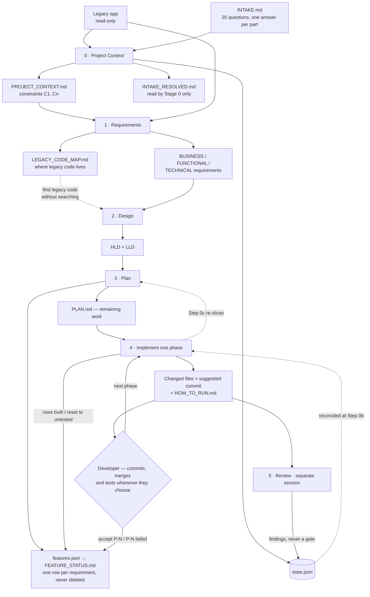
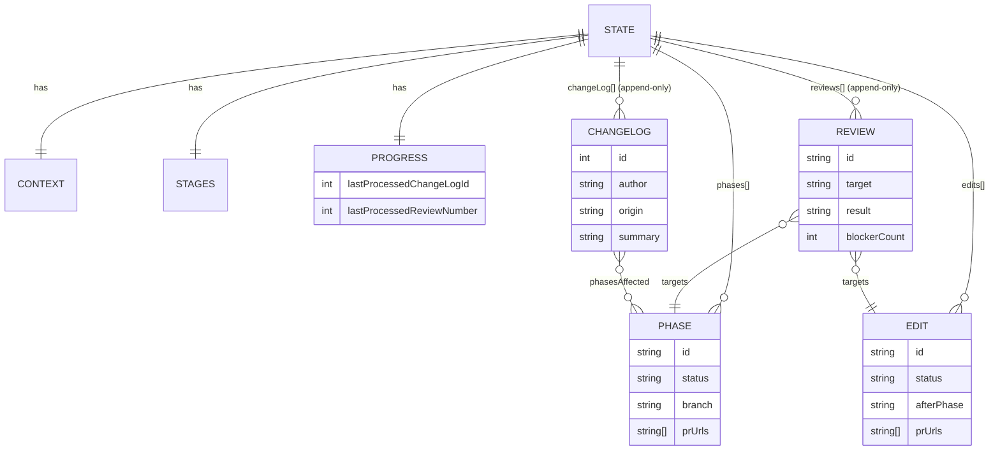
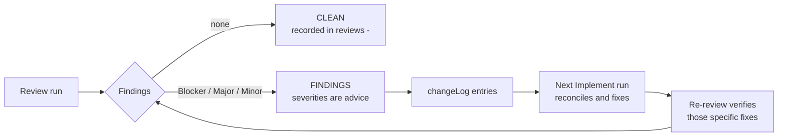

# Design — Modernization Harness

*How the harness is built, as currently implemented. Pairs with [REQUIREMENTS.md](REQUIREMENTS.md).*

---

## 1. Design in one paragraph

At run time, the harness is **eleven Markdown files, three small tools, and a set of vendored agent
skills** (the install scripts and `examples/` only set it up). Six
files are stage instructions, invoked one unit of work per run; two are templates the developer
copies into their project; three are the guides. One tool, `tools/state.py`, reads and writes
`state.json` (DD-18); `tools/codemap.py` writes the legacy code map (DD-27); and `tools/docs.py`
keeps the feature ledger — `features.json`, shown as the generated `FEATURE_STATUS.md` — and makes
the plan's bookkeeping edits (DD-29). The skills in `skills/` are upstream Angular and .NET helpers the
installer copies into `.agents/skills/`; `AGENTS.md` invariant 6 overrides any git step in
them. All coordination
between sessions happens through **two kinds of artifact on disk** — human-readable Markdown
documents and two machine-readable JSON files, `state.json` and `features.json`. Nothing is held in an agent's memory between runs,
because there is no "between runs": each run reads state and all its inputs fresh — even in a
chat it shares with the previous run (DD-25) — does one unit of work, writes state, and stops.

## 2. Components

| File | Kind | Responsibility |
|---|---|---|
| `AGENTS_TEMPLATE.md` | template → `AGENTS.md` | Invariants, authority ladder, the protocol for recording what the developer tells you, and how every message to the developer is written. Loads in **every** session |
| `0_INTAKE_TEMPLATE.md` | template → `INTAKE.md` | The 25 numbered questions, split into single-answer parts (`12a`, `12b`, …; tick boxes where the answer is a choice), their defaults, and which parts are load-bearing — 6 topics, plus Q8 when the schema is new. API description and hand-testing tools, connection identities (database included), role mapping, test sign-in, config/secrets delivery, and supplied API descriptions/collections each have their own part (R2.6) |
| `0_PROJECT_CONTEXT_INSTRUCTIONS.md` | stage | Resolve intake → `PROJECT_CONTEXT.md` + `INTAKE_RESOLVED.md` (its own record, DD-19) + initialize `state.json` |
| `1_REQUIREMENTS_EXTRACTION_INSTRUCTIONS.md` | stage | Legacy code → business / functional / technical requirements + the legacy code map (DD-27) |
| `2_DESIGN_INSTRUCTIONS.md` | stage | Requirements → HLD + LLD |
| `3_PLAN_INSTRUCTIONS.md` | stage | Design → phased plan + `phases[]` + the feature ledger (`features.json`) |
| `4_PHASE_IMPLEMENTATION_INSTRUCTIONS.md` | stage | Build one phase or one minor edit; hand off; stop |
| `5_REVIEW_INSTRUCTIONS.md` | stage | Independent audit; findings back into `state.json` |
| `tools/state.py` | tool | Reads and writes `state.json` for every stage after 0 (DD-18) |
| `tools/codemap.py` | tool | Writes `LEGACY_CODE_MAP_<AppName>.md` from the legacy source, keeping Stage 1's notes on a rerun (DD-27) |
| `tools/docs.py` | tool | Writes `features.json` and renders `FEATURE_STATUS.md` from it; moves a done phase to plan §2 and applies exact plan replacements (DD-29) |
| `skills/` | vendored skills | Upstream Angular and .NET agent skills, installed into `.agents/skills/`; `AGENTS.md` invariant 6 overrides any git step in them |
| `DEVELOPER_GUIDE.md` / `README.md` / `USE_CASES.md` | guide | The reasoning / the five-minute start / the situations you'll hit, by example |

## 3. Pipeline



**Nothing on this diagram blocks.** The developer's testing and the Review stage both feed the
loop without holding it: the only gate is a phase's own falsifiable exit criteria.

Stages 0–2 run once each (and on rerun). Stages 3–4–5 are the loop.

## 4. Key design decisions

| # | Decision | Why |
|---|---|---|
| **DD-1** | **Constraints carry per-stage obligations**, defined once in `PROJECT_CONTEXT §4` | Stage files hold zero project-specific rules, so a new constraint needs no edit to any stage file. This is what makes the harness stack-agnostic (R1) |
| **DD-2** | **Split state from content**: `state.json` for machine state, Markdown for prose | Markdown status tables were unmergeable and drifted. JSON gives lineage, mechanical reconciliation, and diffable history (R7) |
| **DD-3** | **High-water mark** rather than "diff everything" | A run must distinguish new change-log entries from ones it already applied, without re-reading history each time (R7.3) |
| **DD-4** | **One gate: falsifiable exit criteria.** Status moves `pending → in progress → done`, forward only | The acceptance gate cost the developer an hour of testing before any further building, so it forced a choice between working and claiming something untrue. Removing it leaves the self-check — which is meaningful only because it can fail, so a check that never ran (a command that failed to start, a syntax-only check) is never counted as a pass (R4) |
| **DD-5** | **Permanent phase IDs; order lives in the plan** | PRs, branches, and reviews keep meaning what they said, even after re-slicing (R5.4) |
| **DD-6** | **Retrofit phases, never reopened `done` ones** | What is built is built: a delivered phase's ID, scope and place in history stay as written, and the change is new work that supersedes its behavior (R6.3) |
| **DD-7** | **Contract changes are a two-prompt flow** (rerun Stage 2, then next phase) | The pause is the point — it's where the developer catches a design being amended into something they didn't intend |
| **DD-8** | **`AGENTS.md` always loaded** | Stage rules only bind when a stage is invoked; most drift happens in ordinary chat |
| **DD-9** | **`HOW_TO_RUN.md` (how to run it) + `FEATURE_STATUS.md` (what is built and tested)** | Per-phase test docs went stale, and one regenerated file duplicated the plan's own test guides. Splitting *how to run* from *what to check* leaves each written once: the run doc changes only when running changes, and each feature's check sits beside the column the developer ticks (R10). Since DD-29 the ledger's record is `features.json` and `FEATURE_STATUS.md` is its generated view |
| **DD-13** | **Testing is tracked per feature, not per phase** | A phase is a batch of work; a later phase can change what an earlier one delivered, and a phase-level mark cannot express that. A feature row can — it gains the new phase and resets to `untested` (R4.3, UL-5) |
| **DD-24** | **No agent runs git; version control is the developer's.** The agent edits the working tree and hands off a list of changed files and a suggested commit message; the developer branches, commits, pushes, opens PRs and merges | In the developer's environments the agent's git tool hangs, and their projects forbid agent git. Nothing in the pipeline ever needed git *actions*: each phase builds on the files as they stand, so the previous phase's work is present whether or not it was committed. Change detection between runs already had a git-free path — `changeLog[]` and Revision History rows. Replaces DD-14 and DD-17; folds in DD-16. Numbered 24, not 21, so it does not collide with DD-21..23 on the unmerged `stage4-redesign` branch (R11) |
| **DD-25** | **Shape each run to make as few model calls as possible, not to read as few tokens as possible** | The developer's platform (GitLab Duo) bills per model call: each tool call is followed by a new, billed call, and the size of what is read does not change the price. So one command that prints ten input files beats ten reads, and a chained command beats separate ones. The rules live once, in `AGENTS.md §Keeping the Request Count Down`, with Stage 4 naming its own batch points (state and inputs at the start, the predecessor check, Step 0's change-log writes, a task's files, verification and exit criteria, the test-guide walk and run-doc commands, hand-off state writes). Chaining is "where the shell tool allows it", because not every agent's command tool accepts it. Batching stops where a failed call would cost more than it saves: a step writes at most about three files or 400 lines, so one reply cannot hit the model's output limit; a chain stays inside the platform's command time limit, with a long build or test suite run on its own, and after a timeout the agent checks by content before re-running; a file whose edit tool needs its own read first is opened with that tool's reader; and a short Windows PowerShell 5.1 list covers that shell's encoding and syntax traps — each seen in a real Stage 4 run that counted 31 failed or timed-out calls over four runs. A prompt may also approve a plan re-slice in advance, which saves a stop-and-ask round trip (R5.3, Q6) |
| **DD-26** | **Every message to the developer is written to be understood without a follow-up: plain English, summary and "what I need from you" first, every term and ID explained** | The developer often could not follow a stage's closing report — terms undefined, things named only by ID, legacy details assumed remembered — and had to ask again, which on a per-call platform costs a full extra request (DD-25). The rule lives once, in `AGENTS.md §Writing for the Developer`, because messages are written in every session, not only in stage runs; each stage's Definition of Done points to it. Documents keep their precise style — later stages are judged against them — except the summary and advice sections of a review report, which the developer reads as a message. Reminders are written from what was already read, never by opening a file, so the rule adds no tool calls (R12, Q7) |
| **DD-27** | **A legacy code map, built once: `tools/codemap.py` generates a file-and-name index of the legacy source, and Stage 1 adds one section saying where each area lives. Every later stage, and ordinary chat, finds legacy code through it before searching** | On a per-call platform (DD-25) every search and directory listing is a billed call, and Stage 1's survey was held only in that session's memory — so each later stage that needed a legacy detail, and each Stage 1 rerun, hunted for it again. The agent never changes the legacy source (Invariant 1), so the map goes stale only when the developer supplies a new drop, and then rerunning the script refreshes it; a script builds the index for no model calls at all. The index is found by pattern, not by a compiler, so it is a pointer, never evidence: requirements still cite the code. The generated part is marked and rewritten on every run; everything above the marker — Stage 1's notes — is kept, and so is a hand-written map with no marker. The map records the folders excluded from it (the target code, where it sits inside the legacy source), and a refresh reuses them, so once the target code's folder is excluded a new legacy drop cannot pull it into the index; a target folder that does not exist yet at Stage 1 is excluded on a later refresh. The tool never overwrites a file it did not write; where the documents location sits inside the legacy source it leaves that folder out of the map, and it refuses a map placed directly in the legacy root. Without Python, or after a refusal that cannot be fixed, Stage 1 writes its section by hand and the generated part is left out until the tool next runs; a non-map file at the map's path is never overwritten. A rerun that changes only the map writes nothing to `state.json` (R13, Q6) |
| **DD-28** | **A minor edit is registered in `edits[]` once, when its checks pass, already `done` — never `pending` or `in progress`** | Nothing plans an edit ahead the way Stage 3 plans phases, so it has no `pending` state to start from. Registered any earlier, an edit that turns out to touch a contract leaves an entry nothing can close when the run stops (§When a Change Touches a Contract): status moves forward only (DD-4), edits are never dropped, and `done` would claim work that never shipped. A resumed edit run could also register the same edit twice. The cost: an edit run that stops before its checks pass leaves no `edits[]` entry to resume — its stop report says what is half made, and the change-log entries Step 0 writes before any stop record the request. Its other lifecycle fields (`branch`, `prUrls`) behave as a phase's (R6.4) |
| **DD-29** | **The feature ledger is `features.json`, written only through `tools/docs.py`; `FEATURE_STATUS.md` becomes a view the tool generates on every write. The plan stays Markdown, and its two mechanical edits — moving a `done` phase from §5 to a §2 Completed line, and exact text replacements — are tool commands too** | In a real Stage 4 run the agent updated the plan, the run doc and the Markdown ledger with ad-hoc scripts of its own (an exact-replace helper, a row-reset helper) and spent 9–10 calls reading, retrying and checking them — every call billed (DD-25). A Markdown table is also hard to edit exactly: one wrong cell, a lost row or a stray `passed` goes unnoticed. The tool makes each update one call and turns the ledger's rules into refusals: no delete command, permanent unique ids, only the defined `build` / `tested` values, no row `scheduled in` a `done` phase or `built in` a `pending` one, and `phases` that only grow. `tested` takes `passed` / `failed` only with a `--developer-said` flag — a speed bump the tool cannot verify, so invariant 5 stays a rule the agent follows, not one the tool proves. The view carries a hash of its own body, so a hand edit is detected and never overwritten without `--force`; the hash ignores line endings, so a CRLF checkout is not an edit. `feature count` prints the hand-off's features-awaiting-testing count, and `feature check` cross-checks the ledger against `state.json`. A project with a Markdown ledger migrates once with `feature import`, which refuses and names any row it cannot parse and keeps the original as `FEATURE_STATUS.md.bak`. `plan complete` refuses a phase that is not `done`; a phase runs to the next phase heading or the end of §5, and headings in code blocks never count. Inside a phase, a heading at or above the phase's level that is not one of the template's own is refused — except in the last phase, where such a heading (or one a level down after its Exit criteria) ends the phase and stays in the plan. An unclosed code fence, or a removal that would strand a template heading, is refused too — never guessed; it prints the headings it removed; `plan replace` applies all its pairs or none, each old text found exactly once. Writes are UTF-8, keep the file's line endings, and go through a temp file. Same input and output conventions as `state.py`; without Python, the agent edits both files by hand under the same rules and says so (R4.4, R5.5, R5.6, R10.3, Q6) |
| **DD-30** | **Values files for the tools' `@FILE` go in `.harness-tmp/` at the working-tree root, a folder the tools create with a `.gitignore` of `*`; a path outside the repo still works** | The rule was "outside the repo", so nothing temporary could be committed by accident. But GitLab Duo's file tool cannot write outside the repo, so agents wrapped whole JSON payloads in PowerShell here-strings — fragile quoting, more failed calls. A self-ignoring folder keeps the files out of git with no git command (invariant 6) and no installer step; `state.py` and `docs.py` create it on every run, so it exists before the agent needs it. Deleting a values file after use is optional. The code map skips the folder (R7.5) |
| **DD-14** | *Replaced by DD-24.* Was: branch from the currently checked-out branch, PR back at it, and never merge unasked | Kept so references to it still resolve |
| **DD-17** | *Replaced by DD-24.* Was: before branching, detect a branch that is already merged or gone from the remote | With no agent branching there is no spent branch to detect |
| **DD-15** | **The working tree is the truth; `state.json` is a cache** — presence checked by content, never by git state | The developer may commit, merge or edit outside the harness and need not report it; only the files decide whether the previous phase's work is there (R11.3) |
| **DD-16** | *Folded into DD-24.* `prTarget` is kept as a human note that no rule reads | Now widened to every git field: branch naming, PR target and reviewers are the developer's notes (R11.5) |
| **DD-10** | **Plan defaults to "no change"** | Churn burns the developer's review attention and destabilizes what they thought was coming next |
| **DD-11** | **Review is a separate session, read-only on code, and never blocks** | An agent cannot audit its own work; read-only keeps the verdict honest. The gate it used to hold only ever fired for a developer who chose to run it, and its findings already survive through the change log — so it reports and advises instead (R8) |
| **DD-12** | **Documents amended in place; git is the history** | No `_v2` filenames; Revision History rows plus commits give lineage |
| **DD-18** | **`state.json` is read and written through `tools/state.py`, not by the agent directly** | `changeLog[]` and `reviews[]` only grow, so whole-file reads cost more every run; the tool returns the slice asked for (`summary`, `get`, `new`). It also turns the mechanical rules — forward-only status, append-only history, id allocation, numeric `R-<n>` comparison — from prompt text into refusals. Stdlib Python, one file; Stage 0 still writes the initial file by hand, and hand edits under the same rules remain the fallback. A value too awkward for `k=v` goes in an `@FILE` kept in `.harness-tmp/` (DD-30) (R7) |
| **DD-19** | **The resolved intake lives in its own file, `INTAKE_RESOLVED.md`, which only Stage 0 reads** — `PROJECT_CONTEXT §5` is a one-line pointer to it | The answer-by-answer ledger (one row per intake part, ~2–3k tokens) is Stage 0's record and its rerun diff baseline; no later stage uses it, yet every later stage paid for it by opening the context file. The safeguard is a Stage 0 rule: any defaulted or inferred answer that shapes a later stage is also stated in `PROJECT_CONTEXT.md` (its home section, a constraint, or §7), so nothing a later stage needs is only in the ledger. §5 keeps its number so §6–§10 do not shift (R2.3, R2.7) |
| **DD-20** | **Constraint obligations are stored only in `PROJECT_CONTEXT §4`; `state.json` holds no copy of the constraints** | A second copy in `context.constraints` was read by four stages on top of §4, and nothing checked the two stayed equal. DD-1 already makes §4 their home, and DD-2 keeps prose out of `state.json`. Keeping only ids or titles in state was rejected: no stage would read them, and they would be one more copy to drift (R1.3) |

## 5. Data model — `state.json`



`state.json` holds **machine facts only**. The constraints are not in it: they and their
per-stage obligations live only in `PROJECT_CONTEXT §4` (DD-1, DD-20). What a human has tested is not in it: that lives in
the feature ledger, `features.json` (shown as `FEATURE_STATUS.md`), keyed by requirement ID,
because a later phase can change what an earlier one delivered (DD-13). A review has no status to set on its target (DD-11), so there is no
`reviewStatus` anywhere and no `wholeBuild` record.

Rules that hold the model together:

- **Append-only:** `changeLog[]`, `reviews[]`. Correct by superseding, never rewriting.
  `edits[]` entries are never deleted or renumbered, but their lifecycle fields are updated in
  place, like `phases[]`. An edit is registered once its checks pass, already `done` (DD-28).
- **ID allocation:** `changeLog.id` = max + 1; `E-<n>` and `R-<n>` use the next unused *n* for
  their own array. IDs are never reused.
- **`progress` is numeric** — `R-10` sorts before `R-2` as a string, which would silently skip
  reviews.
- **`context.repo` / `context.deployment`** are decided *only* in Stage 0, which is also the
  only stage that writes them. Where `frontendRoot` / `backendRoot` were left null, Stage 2
  settles the tree in **LLD §3a** rather than in state; nothing downstream may invent a layout.

### `features.json` — the feature ledger (DD-29)

Beside `state.json` in the documents location. Stage 3 creates it; every write goes through
`tools/docs.py`, which renders `FEATURE_STATUS.md` from it.

```json
{ "app": "<AppName>", "schemaVersion": 1,
  "features": [ { "id": "FR-7", "feature": "CSV export",
                  "howToCheck": ["Search screen → Export → file downloads with 3 rows"],
                  "phases": ["P-4", "E-2"],
                  "build": "unscheduled | scheduled in P-N | built in P-N",
                  "tested": "untested | passed YYYY-MM-DD | failed YYYY-MM-DD — <symptom>" } ] }
```

- **Rows are never deleted** and an `id` never changes; `phases` only grows, in order.
- **Cross-checks with `state.json`** (`feature check`): every `phases` id exists; no row is
  `scheduled in` a `done` or dropped phase; a row `built in` a phase needs that phase started
  (`in progress` — a run stopped after its ledger update — or `done`) and listed in its `phases`.
- **"accept P-N"** ticks only the rows `built in P-N`, and never overwrites a `failed` one; the
  tool names those, and any `untested` row that lists P-N but was built elsewhere, for the agent
  to ask about.
- **`tested`** is the developer's (invariant 5): the tool writes `passed` / `failed` only under
  `--developer-said`.

## 6. Control flow of a build run (Stage 4)

```mermaid
sequenceDiagram
    participant D as Developer
    participant A as Build agent
    participant S as state.json
    participant F as features.json (via docs.py)
    participant W as Working tree

    D->>A: "Next phase."
    A->>S: read phases[], changeLog[] > mark, reviews[] > mark
    opt a phase was left in progress
        A->>W: resume it (tasks judged by content)
    end
    A->>A: 0a classify — phase / contract change / minor edit
    A->>W: check by content for predecessor's work
    A-->>D: "Building P-3 in <target repo>. Contains P-2's work."
    A->>A: 0b reconcile changes + review findings since last run
    A->>A: 0c refresh plan (default: unchanged)
    opt re-slice needed
        alt approved in this run's prompt
            A->>A: apply; report it first
        else
            A-->>D: propose; wait for approval
        end
    end
    A->>W: edit files task by task — no git
    A->>A: run exit criteria (the only gate)
    A->>S: status=done, advance high-water mark
    A->>F: rows built in P-3; rows P-3 changed reset to untested
    A-->>D: report + 2 counts + changed files + suggested commit message
    Note over D,W: the developer commits, pushes and merges whenever they choose, or not at all
    Note over D,F: testing happens whenever — "accept P-3" ticks rows, gates nothing
```

## 7. Review, and why nothing blocks



The gate this stage used to hold only ever fired for a developer who **chose** to run a review —
it punished the careful and protected nobody else. Its findings already survived without it, via
the change log and the `lastProcessedReviewNumber` high-water mark; the gate only changed *when*
they were fixed, not *whether*. So Review states plainly what it would not build on, and the
developer decides.

That leaves the pipeline with **no hard gate but a phase's own exit criteria**. The trade is
recorded in §10.

## 8. Conflict resolution

A single ladder, stated in `AGENTS.md` and repeated by reference only:

**constraint (`PROJECT_CONTEXT §4`) → plan → LLD → HLD → requirements → rest of context**

A constraint always wins; if honoring it breaks a design contract, that is a blocker for a
human, not a choice the agent makes. Material conflicts are reported, not resolved.

## 9. Traceability

| Requirement | Realized by |
|---|---|
| R1 stack-agnostic | DD-1 constraints + obligations, stored once in `PROJECT_CONTEXT §4` (DD-20); `context.currentStack` / `targetStack` |
| R2 load-bearing questions | `0_INTAKE_TEMPLATE.md` defaults / hard-stops; Stage 0 Step 1 (incl. its cross-checks); `INTAKE_RESOLVED.md` (DD-19); eval check D5 holds the template's shape |
| R3 document order | Stage files 0–5; `stages.<name>.status` |
| R4 one gate + testing record | Plan §The Only Gate; `features.json` / `FEATURE_STATUS.md` (DD-29); `AGENTS.md` §Recording What the Developer Tells You |
| R5 rolling plan | Plan §Refreshing the Plan; Stage 4 Step 0c (incl. approval given in advance); `features.json`; `tools/docs.py` `plan complete` / `plan replace` (DD-29) |
| R6 mid-build change | Stage 4 §0a, §When a Change Touches a Contract, §Minor Edits (DD-28); retrofit phases |
| R7 machine state | `state.json` schema (Stage 0 Output 2); `progress` high-water mark; values files in `.harness-tmp/` (DD-30) |
| R8 review | Stage 5 §Outcome; `reviews[]`; findings reconciled at Stage 4 Step 0b |
| R9 governance | `AGENTS.md` invariants + authority ladder |
| R10 testability | Stage 4 Step 2.3–2.4 (`features.json` through `tools/docs.py`, `HOW_TO_RUN.md`); plan test guides |
| R11 version control | DD-24, DD-15; Stage 4 §Version Control; Step 0's §Pick the work (resume `in progress`, R11.7) and §Starting From the Right Code; `AGENTS.md` invariant 6 |
| R12 plain-language reports | DD-26; `AGENTS.md §Writing for the Developer`; a Definition of Done line in every stage file |
| R13 legacy code map | DD-27; `tools/codemap.py`; Stage 1 Step 1; the legacy-reading inputs of Stages 2–5; `AGENTS.md §Keeping the Request Count Down` |
| Q6 low request count | DD-25, DD-27, DD-29, DD-30; `AGENTS.md §Keeping the Request Count Down`; Stage 4's batch points (state and inputs at the start, the predecessor check, Step 0's change-log writes, a task's files, verification and exit criteria, the test-guide walk and run-doc commands, hand-off state writes) |

## 10. Known trade-offs

- **No hard gates remain.** Nothing prevents a bad build from growing except the developer
  reading the reports — the two counts at every hand-off, and Stage 5 when they run it.
  Defensible for a modernization build with one user and nothing deployed; it would not be for
  a team shipping to production, and whoever inherits this harness should know that is the
  trade that was made.
- **Nothing is committed until the developer commits it.** The agent runs no git (DD-24), so a
  run's work sits uncommitted in the working tree until the developer commits it. Untested code
  reaches a branch only when they put it there. The cost: if they never commit, several phases'
  work piles up as one large uncommitted change, with no per-phase rollback point. Each hand-off
  lists its changed files and a suggested commit message, so committing per phase costs one
  command.
- **Prompt-only enforcement.** Almost every rule depends on the agent following instructions.
  The exceptions are `state.json`'s mechanical rules, which the state tool enforces (DD-18), and
  the ledger's, which `tools/docs.py` enforces (DD-29) — but only when the agent uses them;
  nothing stops a direct edit. Even through the tool, a `passed` or `failed` mark rests on the
  agent's honesty: `--developer-said` cannot be verified. Mitigated by falsifiable exit
  criteria, `AGENTS.md` in every session, and an independent Stage 5.
- **Non-sequential phase IDs** confuse at first read. Deliberate (DD-5); the plan's summary
  table carries the running order.
- **The code map can miss names.** `tools/codemap.py` finds declarations by pattern, so an
  unusual one may be absent from the index, and a file of an unknown kind is listed with no
  names at all. The map only says where to look; an agent that cannot find something in it
  searches as before, and nothing is ever cited from the map (DD-27).
- **Volume.** ~2,900 lines of instruction across the six stage files and two templates;
  the three guides exist to keep the entry cost low (Q1).
- **Git-dependent history.** Superseded design and plan versions exist only as commits the
  developer makes, so a project that keeps `./out/` out of git loses that lineage. The Implement
  stage does not read git: it sees a document change only through `changeLog[]` and Revision
  History rows, so a hand edit to a document with neither goes unnoticed until the developer
  reports it. The same holds for code: with no git, a hand edit to built code is noticed only
  when the developer reports it or a run happens to read that file.
