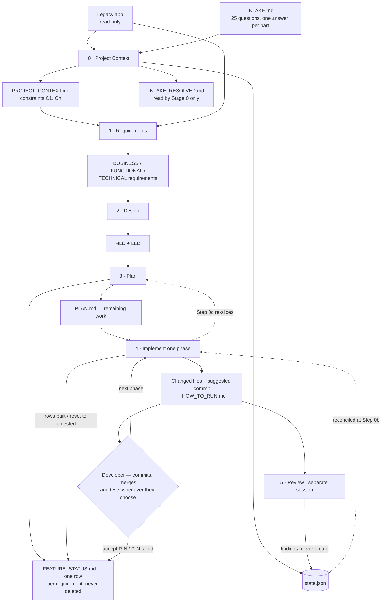
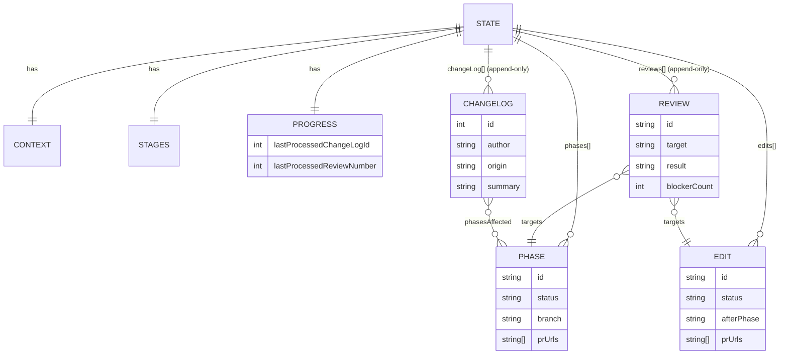
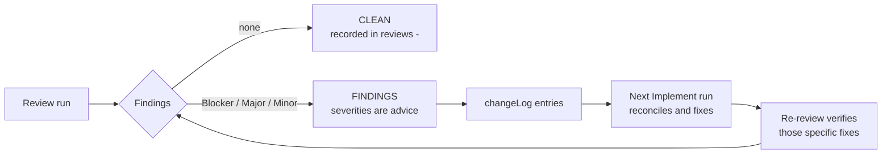

# Design — Modernization Harness

*How the harness is built, as currently implemented. Pairs with [REQUIREMENTS.md](REQUIREMENTS.md).*

---

## 1. Design in one paragraph

The harness is **eleven Markdown files**. Six are stage instructions, invoked one per agent session;
two are templates the developer copies into their project; three are the guides. All coordination
between sessions happens through **two artifacts on disk** — human-readable Markdown documents
and one machine-readable `state.json`. Nothing is held in an agent's memory between runs,
because there is no "between runs": each stage session starts cold, reads state, does one unit
of work, writes state, and stops.

## 2. Components

| File | Kind | Responsibility |
|---|---|---|
| `AGENTS_TEMPLATE.md` | template → `AGENTS.md` | Invariants, authority ladder, and the protocol for recording what the developer tells you. Loads in **every** session |
| `0_INTAKE_TEMPLATE.md` | template → `INTAKE.md` | The 25 numbered questions, split into single-answer parts (`12a`, `12b`, …; tick boxes where the answer is a choice), their defaults, and which parts are load-bearing — 6 topics, plus Q8 when the schema is new. API description and hand-testing tools, connection identities (database included), role mapping, test sign-in, config/secrets delivery, and supplied API descriptions/collections each have their own part (R2.6) |
| `0_PROJECT_CONTEXT_INSTRUCTIONS.md` | stage | Resolve intake → `PROJECT_CONTEXT.md` + `INTAKE_RESOLVED.md` (its own record, DD-19) + initialize `state.json` |
| `1_REQUIREMENTS_EXTRACTION_INSTRUCTIONS.md` | stage | Legacy code → business / functional / technical requirements |
| `2_DESIGN_INSTRUCTIONS.md` | stage | Requirements → HLD + LLD |
| `3_PLAN_INSTRUCTIONS.md` | stage | Design → phased plan + `phases[]` |
| `4_PHASE_IMPLEMENTATION_INSTRUCTIONS.md` | stage | Build one phase or one minor edit; hand off; stop |
| `5_REVIEW_INSTRUCTIONS.md` | stage | Independent audit; findings back into `state.json` |
| `tools/state.py` | tool | Reads and writes `state.json` for every stage after 0 (DD-18) |
| `DEVELOPER_GUIDE.md` / `README.md` / `USE_CASES.md` | guide | The reasoning / the five-minute start / the situations you'll hit, by example |

## 3. Pipeline



**Nothing on this diagram blocks.** The developer's testing and the Review stage both feed the
loop without holding it: the only gate is a phase's own falsifiable exit criteria.

Stages 0–2 run once each (and on rerun). Stages 3–4–5 are the loop.

## 4. Key design decisions

| # | Decision | Why |
|---|---|---|
| **DD-1** | **Constraints carry per-stage obligations**, defined once in `PROJECT_CONTEXT §4` | Stage files hold zero project-specific rules, so a new constraint needs no edit to any stage file. This is what makes the harness stack-agnostic (R1) |
| **DD-2** | **Split state from content**: `state.json` for machine state, Markdown for prose | Markdown status tables were unmergeable and drifted. JSON gives lineage, mechanical reconciliation, and diffable history (R7) |
| **DD-3** | **High-water mark** rather than "diff everything" | A run must distinguish new change-log entries from ones it already applied, without re-reading history each time (R7.3) |
| **DD-4** | **One gate: falsifiable exit criteria.** Status moves `pending → in progress → done`, forward only | The acceptance gate cost the developer an hour of testing before any further building, so it forced a choice between working and claiming something untrue. Removing it leaves the self-check — which is meaningful only because it can fail (R4) |
| **DD-5** | **Permanent phase IDs; order lives in the plan** | PRs, branches, and reviews keep meaning what they said, even after re-slicing (R5.4) |
| **DD-6** | **Retrofit phases, never reopened `done` ones** | What is built is built: a delivered phase's ID, scope and place in history stay as written, and the change is new work that supersedes its behavior (R6.3) |
| **DD-7** | **Contract changes are a two-prompt flow** (rerun Stage 2, then next phase) | The pause is the point — it's where the developer catches a design being amended into something they didn't intend |
| **DD-8** | **`AGENTS.md` always loaded** | Stage rules only bind when a stage is invoked; most drift happens in ordinary chat |
| **DD-9** | **`HOW_TO_RUN.md` (how to run it) + `FEATURE_STATUS.md` (what is built and tested)** | Per-phase test docs went stale, and one regenerated file duplicated the plan's own test guides. Splitting *how to run* from *what to check* leaves each written once: the run doc changes only when running changes, and each feature's check sits beside the column the developer ticks (R10) |
| **DD-13** | **Testing is tracked per feature, not per phase** | A phase is a batch of work; a later phase can change what an earlier one delivered, and a phase-level mark cannot express that. A feature row can — it gains the new phase and resets to `untested` (R4.3, UL-5) |
| **DD-24** | **No agent runs git; version control is the developer's.** The agent edits the working tree and hands off a list of changed files and a suggested commit message; the developer branches, commits, pushes, opens PRs and merges | In the developer's environments the agent's git tool hangs, and their projects forbid agent git. Nothing in the pipeline ever needed git *actions*: each phase builds on the files as they stand, so the previous phase's work is present whether or not it was committed. Change detection between runs already had a git-free path — `changeLog[]` and Revision History rows. Replaces DD-14 and DD-17; folds in DD-16. Numbered 24, not 21, so it does not collide with DD-21..23 on the unmerged `stage4-redesign` branch (R11) |
| **DD-14** | *Replaced by DD-24.* Was: branch from the currently checked-out branch, PR back at it, and never merge unasked | Kept so references to it still resolve |
| **DD-17** | *Replaced by DD-24.* Was: before branching, detect a branch that is already merged or gone from the remote | With no agent branching there is no spent branch to detect |
| **DD-15** | **The working tree is the truth; `state.json` is a cache** — presence checked by content, never by git state | The developer may commit, merge or edit outside the harness and need not report it; only the files decide whether the previous phase's work is there (R11.3) |
| **DD-16** | *Folded into DD-24.* `prTarget` is kept as a human note that no rule reads | Now widened to every git field: branch naming, PR target and reviewers are the developer's notes (R11.5) |
| **DD-10** | **Plan defaults to "no change"** | Churn burns the developer's review attention and destabilizes what they thought was coming next |
| **DD-11** | **Review is a separate session, read-only on code, and never blocks** | An agent cannot audit its own work; read-only keeps the verdict honest. The gate it used to hold only ever fired for a developer who chose to run it, and its findings already survive through the change log — so it reports and advises instead (R8) |
| **DD-12** | **Documents amended in place; git is the history** | No `_v2` filenames; Revision History rows plus commits give lineage |
| **DD-18** | **`state.json` is read and written through `tools/state.py`, not by the agent directly** | `changeLog[]` and `reviews[]` only grow, so whole-file reads cost more every run; the tool returns the slice asked for (`summary`, `get`, `new`). It also turns the mechanical rules — forward-only status, append-only history, id allocation, numeric `R-<n>` comparison — from prompt text into refusals. Stdlib Python, one file; Stage 0 still writes the initial file by hand, and hand edits under the same rules remain the fallback (R7) |
| **DD-19** | **The resolved intake lives in its own file, `INTAKE_RESOLVED.md`, which only Stage 0 reads** — `PROJECT_CONTEXT §5` is a one-line pointer to it | The answer-by-answer ledger (one row per intake part, ~2–3k tokens) is Stage 0's record and its rerun diff baseline; no later stage uses it, yet every later stage paid for it by opening the context file. The safeguard is a Stage 0 rule: any defaulted or inferred answer that shapes a later stage is also stated in `PROJECT_CONTEXT.md` (its home section, a constraint, or §7), so nothing a later stage needs is only in the ledger. §5 keeps its number so §6–§10 do not shift (R2.3, R2.7) |
| **DD-20** | **Constraint obligations are stored only in `PROJECT_CONTEXT §4`; `state.json` holds no copy of the constraints** | A second copy in `context.constraints` was read by four stages on top of §4, and nothing checked the two stayed equal. DD-1 already makes §4 their home, and DD-2 keeps prose out of `state.json`. Keeping only ids or titles in state was rejected: no stage would read them, and they would be one more copy to drift (R1.3) |

## 5. Data model — `state.json`



`state.json` holds **machine facts only**. The constraints are not in it: they and their
per-stage obligations live only in `PROJECT_CONTEXT §4` (DD-1, DD-20). What a human has tested is not in it: that lives in
`FEATURE_STATUS.md`, keyed by requirement ID, because a later phase can change what an earlier
one delivered (DD-13). A review has no status to set on its target (DD-11), so there is no
`reviewStatus` anywhere and no `wholeBuild` record.

Rules that hold the model together:

- **Append-only:** `changeLog[]`, `reviews[]`. Correct by superseding, never rewriting.
  `edits[]` entries are never deleted or renumbered, but their lifecycle fields are updated in
  place, like `phases[]`.
- **ID allocation:** `changeLog.id` = max + 1; `E-<n>` and `R-<n>` use the next unused *n* for
  their own array. IDs are never reused.
- **`progress` is numeric** — `R-10` sorts before `R-2` as a string, which would silently skip
  reviews.
- **`context.repo` / `context.deployment`** are decided *only* in Stage 0, which is also the
  only stage that writes them. Where `frontendRoot` / `backendRoot` were left null, Stage 2
  settles the tree in **LLD §3a** rather than in state; nothing downstream may invent a layout.

## 6. Control flow of a build run (Stage 4)

```mermaid
sequenceDiagram
    participant D as Developer
    participant A as Build agent
    participant S as state.json
    participant F as FEATURE_STATUS.md
    participant W as Working tree

    D->>A: "Next phase."
    A->>S: read phases[], changeLog[] > mark, reviews[] > mark
    A->>W: check by content for predecessor's work
    A-->>D: "Building P-3 in <target repo>. Contains P-2's work."
    A->>A: 0a classify — phase / contract change / minor edit
    A->>A: 0b reconcile changes + review findings since last run
    A->>A: 0c refresh plan (default: unchanged)
    opt re-slice needed
        A-->>D: propose; wait for approval
    end
    A->>W: edit files task by task — no git
    A->>A: run exit criteria (the only gate)
    A->>S: status=done, advance high-water mark
    A->>F: rows built in P-3; rows P-3 changed reset to untested
    A-->>D: report + 2 counts + changed files + suggested commit message
    Note over D,W: the developer commits, pushes and merges whenever they choose, or not at all
    Note over D,F: testing happens whenever — "accept P-3" ticks rows, gates nothing
```

## 7. Review, and why nothing blocks



The gate this stage used to hold only ever fired for a developer who **chose** to run a review —
it punished the careful and protected nobody else. Its findings already survived without it, via
the change log and the `lastProcessedReviewNumber` high-water mark; the gate only changed *when*
they were fixed, not *whether*. So Review states plainly what it would not build on, and the
developer decides.

That leaves the pipeline with **no hard gate but a phase's own exit criteria**. The trade is
recorded in §10.

## 8. Conflict resolution

A single ladder, stated in `AGENTS.md` and repeated by reference only:

**constraint (`PROJECT_CONTEXT §4`) → plan → LLD → HLD → requirements → rest of context**

A constraint always wins; if honoring it breaks a design contract, that is a blocker for a
human, not a choice the agent makes. Material conflicts are reported, not resolved.

## 9. Traceability

| Requirement | Realized by |
|---|---|
| R1 stack-agnostic | DD-1 constraints + obligations, stored once in `PROJECT_CONTEXT §4` (DD-20); `context.currentStack` / `targetStack` |
| R2 load-bearing questions | `0_INTAKE_TEMPLATE.md` defaults / hard-stops; Stage 0 Step 1 (incl. its cross-checks); `INTAKE_RESOLVED.md` (DD-19); eval check D5 holds the template's shape |
| R3 document order | Stage files 0–5; `stages.<name>.status` |
| R4 one gate + testing record | Plan §The Only Gate; `FEATURE_STATUS.md`; `AGENTS.md` §Recording What the Developer Tells You |
| R5 rolling plan | Plan §Refreshing the Plan; Stage 4 Step 0c; `FEATURE_STATUS.md` |
| R6 mid-build change | Stage 4 §0a, §When a Change Touches a Contract; retrofit phases |
| R7 machine state | `state.json` schema (Stage 0 Output 2); `progress` high-water mark |
| R8 review | Stage 5 §Outcome; `reviews[]`; findings reconciled at Stage 4 Step 0b |
| R9 governance | `AGENTS.md` invariants + authority ladder |
| R10 testability | Stage 4 Step 2.3–2.4 (`FEATURE_STATUS.md`, `HOW_TO_RUN.md`); plan test guides |
| R11 version control | DD-24, DD-15; Stage 4 §Version Control, §Starting From the Right Code; `AGENTS.md` invariant 6 |

## 10. Known trade-offs

- **No hard gates remain.** Nothing prevents a bad build from growing except the developer
  reading the reports — the two counts at every hand-off, and Stage 5 when they run it.
  Defensible for a modernization build with one user and nothing deployed; it would not be for
  a team shipping to production, and whoever inherits this harness should know that is the
  trade that was made.
- **Nothing is committed until the developer commits it.** The agent runs no git (DD-24), so a
  run's work sits uncommitted in the working tree until the developer commits it. Untested code
  reaches a branch only when they put it there. The cost: if they never commit, several phases'
  work piles up as one large uncommitted change, with no per-phase rollback point. Each hand-off
  lists its changed files and a suggested commit message, so committing per phase costs one
  command.
- **Prompt-only enforcement.** Almost every rule depends on the agent following instructions.
  The exception is `state.json`'s mechanical rules, which the state tool enforces (DD-18) —
  but only when the agent uses it; nothing stops a direct edit. Mitigated by falsifiable exit
  criteria, `AGENTS.md` in every session, and an independent Stage 5.
- **Non-sequential phase IDs** confuse at first read. Deliberate (DD-5); the plan's summary
  table carries the running order.
- **Volume.** ~2,900 lines of instruction across the six stage files and two templates;
  the three guides exist to keep the entry cost low (Q1).
- **Git-dependent history.** Superseded design and plan versions exist only as commits the
  developer makes, so a project that keeps `./out/` out of git loses that lineage. The Implement
  stage does not read git: it sees a document change only through `changeLog[]` and Revision
  History rows, so a hand edit to a document with neither goes unnoticed until the developer
  reports it. The same holds for code: with no git, a hand edit to built code is noticed only
  when the developer reports it or a run happens to read that file.
