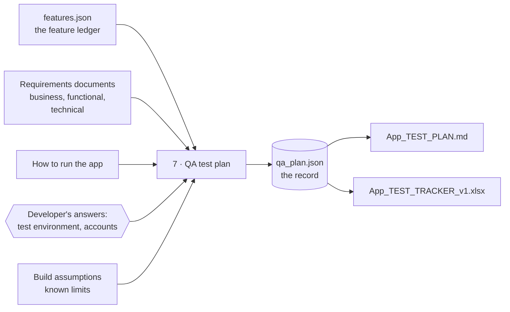

# Proposal — a QA stage: the test plan and the test tracker

*Status: **built 2026-11-12** as Stage 7 — the decision is DD-37 in [DESIGN.md](DESIGN.md), the requirement R16 in [REQUIREMENTS.md](REQUIREMENTS.md), the stage file [7_QA_PLAN_INSTRUCTIONS.md](../ModernizationHarness/7_QA_PLAN_INSTRUCTIONS.md). This file is the proposal as approved, kept for its reasoning. Where the build differs: the tool is about 1,200 lines, not 800–1,000; an allowed exception names a test case, a plan section or `ledger` (a requirement's name); the Excel check is automated where Excel is installed; and no project constraint can bind Stage 7 yet (no obligation key — see DESIGN.md §10).*

---

## 1. The idea in one paragraph

A new, optional stage — **Stage 7, the QA test plan** — runs once some of the app is built. It
reads what the pipeline already knows (the feature ledger, the requirements, how to run the app),
and writes two files
for a **QA tester**: a short **test plan** that says *what to test, how, and with which accounts*,
and an **Excel tracker** where the tester records *what they ran and what happened*. What the
pipeline cannot know — the test server's address, the testers' accounts — it fills with a best
guess marked *To confirm*, and asks the developer about in its closing message. Every built
feature gets at least one test case, and a script checks that — so "covers all the features" is
proved by a tool, not taken on trust. Like Stage 6, it only reads the pipeline's files. It never
changes the build, the feature ledger or `state.json`.

### Words used below

- **Stage** — one step of the harness, run by an agent from its own instruction file. Stages 0–6
  exist today: 0 project context, 1 requirements, 2 design, 3 plan, 4 build, 5 review, 6 client pack.
- **Phase** — one slice of the build (`P-3`). A **minor edit** (`E-2`) is a small change made outside
  the phases.
- **Requirements documents** — Stage 1 writes three: the **business** requirements (BRD — goals,
  roles, business rules), the **functional** requirements (FRD — features, screens, workflows,
  validation rules) and the **technical** requirements (TRD — architecture, and in its §7 the
  non-functional ones such as speed and security).
- **Feature ledger** — `features.json` (shown to people as `FEATURE_STATUS.md`). One row per
  requirement ID (`FR-7`, `BR-3`, `VR-2`, …), saying whether it is built and whether the developer
  has tested it. Stage 3 creates it, and it must have a row for **every** requirement ID.
- **Test case** — one thing a tester checks: a few numbered steps and the result they should see.
- **Happy path** — the normal use, with good input. **Smoke test** — the first quick check that the
  app starts and you can sign in; if it fails, there is no point testing further.
- **Coverage** — every feature has at least one test case that checks it.
- **The record** — `qa_plan.json`, the one file the test plan and the tracker are both made from.
- **Values file** — a small JSON file the agent writes and passes to a tool, so the tool does the
  exact, fiddly part. It goes in `.harness-tmp/`, as with the other tools.

---

## 2. Where it fits



- **When it runs:** any time after Stage 3 (so the ledger exists). It writes test cases only for
  features that are **built**. The others go under *Not in this build*, automatically. So QA can
  start mid-build, and a new version follows when more is built (§9).
- **Outside the build loop**, like Stage 6. Nothing in Stages 0–6 reads what it writes. Running it
  — or never running it — changes nothing for the build.
- **Separate from Stage 6.** Stage 6 cleans up documents for the client. This stage writes new
  documents for a tester. They can run in either order. The QA files go in their own folder,
  `<documents>/qa/`, so Stage 6's folder and its rules stay untouched.

---

## 3. What it reads (read only), and what it asks

| Input | What it gives the test plan |
|---|---|
| The ledger, through `docs.py feature show` (one call, every row) | **The list of things to cover**, which are built, and each row's *How to check* line |
| Functional requirements, §2–§6 | Feature details, screens, workflows (§4), validation rules (§6) |
| Business requirements, §4–§6 | Roles, business rules, who may do what |
| Technical requirements, §7 | Non-functional needs — only the ones a person can check by hand |
| `HOW_TO_RUN.md`, or Stage 6's client run document if one exists | How to start the app, if testers run it themselves |
| `PROJECT_CONTEXT.md` §3 | Environments and test data |
| `PROJECT_CONTEXT.md` §2 | The tool the project uses to test an API by hand, such as Postman or Swagger (the intake asks for it, in question 5e) |
| `BUILD_ASSUMPTIONS_<App>.md` | Known limits — so the tester does not report a known gap as a bug |
| The delivered code | Only to get exact screen names, button labels and error messages where the requirements are vague |

**Four questions — asked at the end, not in the middle.** The pipeline knows how a *developer*
signs in — often as made-up users that exist only on their own machine. A tester needs something
else. The agent does **not** stop to ask (a stop in the middle of a run needs extra "where was I?"
logic). Instead it writes its best guess for each, marked *To confirm* in the plan, and lists the
four in its closing message:

1. Where will testers use the app — a test server's address, or each on their own machine?
2. The test account for each role — names only — and where their passwords are kept.
3. Which browsers to test in.
4. Is any test data loaded already, or must testers create it?

When the developer answers, a short run records the answers and rebuilds the plan (§9). The
answers live in the plan only — the tracker names roles, not accounts — so the tracker does not
change. A password is never written anywhere.

---

## 4. What it writes — three files, in `<documents>/qa/`

| File | For whom | What it is |
|---|---|---|
| `qa_plan.json` | The tool and the agent | **The record**: every test case, the developer's answers, the plan's short written sections, requirements left out on purpose (with a reason), allowed exceptions to the forbidden-words check (§5), and — for each tracker written — a copy of the ledger as it stood then (§9). Changed **only through the tool** — like `features.json` |
| `<App>_TEST_PLAN.md` | The QA tester and their lead | **Generated whole** from the record on every change. If someone edits it by hand, the tool notices and refuses to overwrite it (as `docs.py` already does for `FEATURE_STATUS.md`). The agent then carries the edit into the record and rebuilds with `--force` |
| `<App>_TEST_TRACKER_v<N>.xlsx` | The QA tester | Generated from the record — a new version each time something changes after the tester has saved it (§7). The tester fills it in |

Why one record instead of writing the plan directly: the plan and the tracker must list exactly the
same test cases. If both are made from one record, they cannot disagree. The harness already made
the same choice for the feature ledger (`features.json` → `FEATURE_STATUS.md`, design decision
DD-29).

---

## 5. The test plan — its sections

Short on purpose: a tester should be able to read the front part in ten minutes.

1. **About this plan** — the app, the version of the plan, the date.
2. **Scope** — what this round covers; *not in this build*; *not tested by hand*, each with its
   reason (e.g. "checked by automated tests", "needs production-sized load").
3. **Before you start** — where the app is (from the developer's answers). If testers run it
   themselves, the start steps in plain words (or the client run document's name, if Stage 6 made
   one). Browsers.
4. **Test accounts** — one line per role: which account to use. Names only; where the password is
   kept, never the password.
5. **Test data** — what must exist first, and how to get it.
6. **How to record results** — run the smoke tests first; what each priority and each status means;
   put a bug-tracker ticket number in *Defect ID*.
7. **Known limits** — from the build's assumptions, in plain words: "do not log this as a bug".
8. **Test cases** — one heading per feature group (the ledger's groups), one block per case:

   ```markdown
   #### TC-12 — Export search results to CSV
   **Checks:** FR-7 · **Type:** Positive · **Priority:** High
   **Before:** signed in as *Clerk*; at least 3 orders exist.
   1. Open *Orders → Search*, leave every filter empty, press *Search*.
   2. Press *Export*.
   **Expect:** a file `orders.csv` downloads with a header row and 3 data rows.
   ```

9. **Coverage** — each requirement ID, and the test cases that check it.

**No harness words.** The plan never names a phase, a constraint ID, a stage, a harness file or a
tool — the tester has never heard of them. Requirement IDs (`FR-7`) stay: the client's copy of the
requirements (Stage 6) keeps them, so a tester can look one up. The check reuses Stage 6's list of
forbidden words (§7).

**Allowed exceptions.** That list also catches short codes such as `E-102` or `Q3`, because the
harness uses that shape for its own IDs. But a test's expected result may *need* such text — an
error code the app really shows, a "Q3 report". The agent must never reword an expected result to
please the check, because then the test would be wrong. So the record keeps a short list of
**allowed exceptions**: the exact text, the test case or plan section it is in, and why (as
Stage 6 does in its notes). The check skips those, and only those.

---

## 6. Which test cases to write — five simple rules

1. **Every built ledger row gets at least one test case, or is listed as *not tested by hand*, with
   a reason.** This is the coverage rule, and the tool checks it. Because the ledger has a row for
   every requirement ID, nothing can slip through.
2. **Happy path first.** Start from the row's *How to check* line — but rewrite it as **screen
   steps**. Those lines are written for developers (`GET /api/employees?q=smith → 200`).
3. **Validation rules get a negative case** — wrong input, an empty field, a value past a limit —
   with the exact error message expected.
4. **Role restrictions get an access case** — "sign in as *Viewer*, try to delete an order; expect
   it refused".
5. **Workflows get one end-to-end case**, and the plan opens with **smoke cases**: the app starts,
   and each role can sign in.

**A feature with no screen** (an API only): its cases use the hand-testing tool the project
already named (Postman, Swagger, …) — the request to send and the response to expect. If the
project named none, it is *not tested by hand*, reason: "no screen and no testing tool".

**Priority:** *High* — smoke, workflows, business rules, access. *Medium* — the rest. *Low* —
wording and layout. **Type:** Smoke, Positive, Negative, Access, Workflow, Non-functional.

This is a sensible first plan, not exhaustive testing — and the plan says so.

---

## 7. The tool — `tools/qaplan.py`

One file, standard-library Python, the same conventions as `docs.py`.

Four commands. Every change goes through one of them, `apply`, so several changes cost one call.

| Command | What it does |
|---|---|
| `status` | Reads only. Where things stand: the version; built rows with no test case; and what changed in the ledger since the last tracker was written (§9) |
| `apply "@file"` | Makes a batch of changes from one values file, all or none. The file may hold any mix of: **add** test cases; **edit** a case (marked *changed*); **retire** a case (never deleted, and its ID never reused, so an old tracker row keeps its meaning); **exclude** a requirement as *not tested by hand*, with a reason; **set** the developer's answers and the plan's short written sections; **allow** an exception to the forbidden-words check. **The tool gives out test IDs** (`TC-1`, `TC-2`, …), so batches cannot clash. It refuses a case with no steps or no expected result, and a *Checks* ID that is not a ledger row |
| `check` | Reads only. The proof: every built ledger row is covered or excluded; every case is complete; no forbidden word in the plan except an allowed one; the plan matches the record. It also **warns** while any *To confirm* guess is left, so a plan is not handed to a tester with guesses in it unnoticed |
| `build` | Writes the plan, and the tracker. Each tracker is saved with a copy of the ledger as it stood (§9). See below for when it writes a new version |

**When `build` writes a tracker.**

- **No tracker yet** → it writes `v1`.
- **The current tracker is exactly as the tool wrote it** (the tool keeps its fingerprint — a hash —
  in the record) → it replaces it. So a fix found before anyone has opened the tracker does not
  force a new version.
- **The tester has saved it** (Excel changes the bytes) and anything the tracker shows would now
  be different → it writes the **next version** (`v2`) and leaves the old file alone. "Different"
  includes a feature **rebuilt** since the last tracker even when its test steps did not change:
  its cases must now say *Yes* in *Changed since last version?*, so the tester knows to re-test.
  A new version starts this way, by itself; there is no separate command for it.
- **Nothing in the tracker would change** (e.g. only the developer's answers came in) → it
  rewrites the plan only.
- `build --force` — rewrite a plan someone edited by hand (§4), once the edit is in the record.

Replacing an unsaved tracker only protects the file in `qa/`. So the closing message says: **the
tester works in the file in `qa/`**, or, once a copy is sent out, that copy is final — changes go
in the next version.

**Size:** about 800–1,000 lines (for comparison: `docs.py` is 1,399, `clientdocs.py` 1,575). The
Excel part is about 300 of them. The hand-edit protection reuses about 20 lines' worth of logic
from `docs.py`.

**Forbidden words:** imported from `clientdocs.py`, not copied, so there is one list. That list
must also gain this stage's own names (`stage 7`, `qaplan.py`, `qa_plan.json`) — §14.

---

## 8. The Excel tracker

Two sheets — kept small on purpose.

**Sheet 1 — Test cases.** One row per test case.

| Columns | Filled by |
|---|---|
| Test ID, Area, Checks, Title, Type, Priority, Before you start, Steps, Expected result, **Changed since last version?** | The tool. Shaded grey, meaning "don't edit" |
| **Status** — drop-down: *Not run, Pass, Fail, Blocked, Skipped* | The tester |
| Actual result, Tested by, Date, Defect ID, Notes | The tester |

The header row stays visible when scrolling, every column has a filter, text wraps, and Status
turns green for *Pass*, red for *Fail*, amber for *Blocked*.

**Sheet 2 — Summary.** Counts that update as the tester types: cases in each status, overall and
per area; *High* cases not yet passed; the pass rate.

**How a tool makes an Excel file with no extra software.** An `.xlsx` file is really a zip folder
of small XML text files. Python's built-in `zipfile` can write one, so no extra library is needed —
the harness rule for every tool, because the developer's machine cannot always install packages.
Drop-downs, colours, frozen headers, filters and formulas are all plain XML inside that zip. The
file tells Excel to work out the formulas when it opens (otherwise a viewer may show 0).

**The risk, and how to test it.** One wrong piece of XML and Excel shows a "we found a problem,
repair?" message. The automated tests can check the zip and the XML, but not Excel itself. So the
implementation has one manual check: open the sample tracker once in Excel (and LibreOffice), and
keep that sample in the tests.

**Not included,** to stay simple: a defects sheet (a *Defect ID* column is enough — most teams have
a bug tracker), a read-me sheet (plan §6 says it), and copying results from an old tracker into a
new one (that means reading files Excel has saved, the most fragile code there would be). Instead,
the *Changed since last version?* column tells the tester which old results they can copy across
themselves.

---

## 9. A run, step by step — and a new version

Built to keep the number of model calls low, because each call is billed on GitLab Duo (DD-25).

| Step | What happens | Calls, roughly |
|---|---|---|
| 0 | `state.py get`, `docs.py feature show`, `qaplan.py status` — chained into one call where the shell allows. If phases are still to be built, say so and carry on with what is built | 1 |
| 1 | Read the inputs in §3 in one batch; open code only where a label or message is unclear | 2–5 |
| 2 | The plan's short written sections, with best guesses marked *To confirm*: one values file, `qaplan.py apply` | 2 |
| 3 | For each feature group: one values file of test cases, then `qaplan.py apply`. **At most ~15 cases per values file** — split a bigger group — so one reply never hits the model's output limit | 2 per group |
| 4 | `qaplan.py check`; fix what it names (one `apply`); `qaplan.py build` | 2–4 |
| 5 | Closing message: how many cases, by priority; *not in this build*; *not tested by hand*; and the four questions (§3) | 0 |

A ten-group app is roughly **30 calls** for a first plan. A new version with a few changed
features is roughly **8–12**.

**Prompts**

| The developer says | The agent does |
|---|---|
| `run stage 7 — app: <App>` | Steps 0–5. Run again later, it brings the plan up to date with the ledger (below) |
| `stage 7 answers — app: <App>: <the answers>` | Records the answers with one `apply`, then `build` — about 3 calls |
| `read through the QA plan — app: <App>` | An optional read-through in a **new session** (below) |

**Running it again, after more is built.** Run it when more is built or the requirements changed.

1. **What changed is worked out from the record, not the ledger.** The ledger keeps no history. So
   every time `build` writes a tracker, the record saves a copy of every ledger row's *build*
   value and *phases* list (which holds both phases and minor edits) **as the tester received
   it**. `status` compares today's ledger with the copy for the latest tracker and lists:
   - rows **newly built** — write cases for them;
   - rows **rebuilt** — a later phase or minor edit changed them — their cases must be re-tested,
     and maybe changed;
   - **new rows**.
2. **Changed wording** cannot be seen from IDs. The agent reads the *Revision History* rows of the
   functional and business requirements added since the last version's date.
3. The agent adds, edits and retires cases in one or two `apply` calls; `build` writes the next
   tracker, `<App>_TEST_TRACKER_v2.xlsx`, if the tester has already saved `v1`. The old tracker is
   never touched — it is the tester's work. Cases that changed, or whose feature was rebuilt, say
   *Yes* in *Changed since last version?*.

**The optional read-through.** In a new session, an agent runs `check` and reads the plan as a
tester would: can a stranger follow each step? Is each expected result something you can see? Does
each case check what it claims (open the requirement)? Are the *not tested by hand* reasons honest?
It reports to the developer, and changes nothing. No rounds, no log — the developer decides
whether to run Stage 7 again to fix things.

---

## 10. What this stage never does

- **Never marks anything tested in the ledger.** Only the developer may say a feature passed or
  failed (invariant 5 — one of the harness's fixed rules). The tracker is the tester's record and
  stays separate. To put a QA result in the ledger, the developer says so the normal way.
- **Never writes to a pipeline document or `state.json`** — not even the change log.
- **Never touches Stage 6's folder** (`<documents>/artifacts/`).
- **Never runs the app** or writes automated tests. It writes a plan for a person.
- **Never writes a secret.** Accounts are named; passwords are not.
- **Never overwrites a tracker a tester has saved.**

---

## 11. Decisions for you

1. **A separate Stage 7?** Proposed: **yes**, rather than a new part of Stage 6 (the client pack).
   Stage 6 is already the largest stage, and a test plan has a different reader and gets new
   versions during testing.
2. **Where the files go.** Proposed: **`<documents>/qa/`**, its own folder. Putting them in Stage 6's
   `artifacts/` folder would mean changing the rule that only Stage 6 writes there. The plan is
   free of harness words either way, so the developer can still send it to the client.
3. **The read-through** (§9): keep it as one optional, report-only check? Or a full review with up
   to three logged rounds, like Stage 6? Proposed: **the simple one.**
4. **Print the plan to PDF** with the existing `md2pdf.py`? Proposed: yes — one command, no new
   code.

---

## 12. Simpler options that were considered and dropped

| Option | Why not |
|---|---|
| **CSV instead of Excel** | No drop-downs, colours or summary; Excel also mangles IDs and dates in CSV |
| **The `openpyxl` library** | Makes Excel easy, but is not on the developer's machine; harness tools use the standard library only |
| **The agent writes the plan; the tool reads it back for the tracker** | Steps do not fit in a Markdown table, and reading free text back is fragile |
| **The agent writes the Excel file itself** | An agent cannot reliably write a binary zip file |
| **Find requirement IDs by scanning the requirements documents** | Their ID styles vary (`VR-1..VR-8`, `NFR-1..7`) and old IDs appear in the history rows. The ledger already lists every ID once |
| **Copy old results into the new tracker** | Needs reading Excel-saved files — the most fragile code there would be. The *Changed?* column does most of the job |
| **Stop mid-run to ask the developer about the test environment** | A stop needs "where was I?" logic when the next run starts. Best guesses marked *To confirm*, with the questions in the closing message, need none |
| **One command per kind of change** (`add`, `edit`, `retire`, …) | Each is a billed call; one `apply` with a list does a batch in one call |
| **Write test results back into the ledger** | Breaks invariant 5 — only the developer marks a feature tested |

---

## 13. Known limits of this design

- The test cases are only as good as the requirements and the *How to check* lines. Where those
  are thin, the plan is thin; the read-through is where that shows.
- Changed requirement *wording* is found by reading revision rows, which relies on Stage 1 having
  written them.
- Excel's own "repair" check cannot be automated here; it rests on one manual check.

---

## 14. What changes if this is approved (for later)

No file changes yet. On approval, in this order (AGENTS.md §Design changes):

1. `docs/DESIGN.md` — a new decision (DD-37), the components table, the pipeline diagram, the
   `qa_plan.json` shape in §5. `docs/REQUIREMENTS.md` — a new requirement (R16).
2. New: `ModernizationHarness/7_QA_PLAN_INSTRUCTIONS.md`, `tools/qaplan.py` and its plain-text copy
   `tools/qaplan.txt` (every tool has one, kept identical by a test), and
   `eval/tests/test_qaplan_tool.py` with a sample tracker.
3. `tools/clientdocs.py` — its forbidden-words list gains Stage 7's names (its tests too).
4. `AGENTS_TEMPLATE.md` — the stage list; that `<documents>/qa/` is Stage 7's; that the tracker is
   not the ledger. `DEVELOPER_GUIDE.md`, `README.md`, `USE_CASES.md`, and the repo's own `AGENTS.md`
   (a row in its "which document describes what" table, and the new test in §Check your work).
5. The eval size budgets (`eval/evalkit/checks/size.py`), which list the stage files.
6. The installers copy the whole harness folder, so they need no change.
