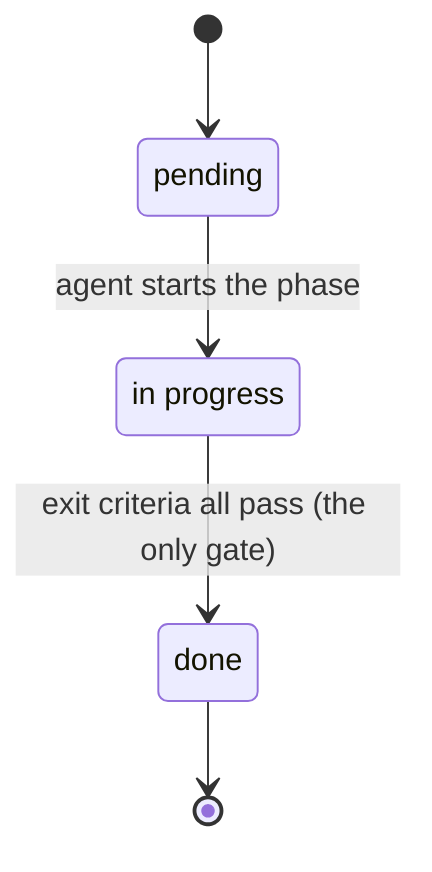

# Requirements — Modernization Harness

*What the harness is required to do, as currently implemented. Reverse-engineered from the six stage
files, the two templates, and `DEVELOPER_GUIDE.md`.*

---

## 1. Purpose

The harness is a **prompt-based process** — not code — that lets one developer modernize a legacy
application with a coding agent, **one small testable increment at a time**, without losing
control of scope, quality, or history.

It ships as Markdown files the developer copies into their project and cites in prompts, plus
three small stdlib-Python tools (the state tool, the legacy code map tool, and the documents tool that keeps the feature ledger and the plan's bookkeeping), vendored agent skills, and install scripts that copy it all
into place. No runtime or service to maintain.

## 2. Users & actors

| Actor | Role |
|---|---|
| **Developer** | Drives the pipeline, does all version control (branches, commits, PRs, merges), and is the *only* one who can record that something was tested |
| **Build agent** | Any LLM coding agent, running one stage per session |
| **Review agent** | The same, in a *separate* session, auditing what the build agent produced |

## 3. Scope

**In scope:** intake, requirements extraction, design, phased planning, incremental
implementation, and independent review — plus the state and paper trail that ties them together.

**Out of scope:** running the legacy app, executing data migration, deployment, load testing,
and anything that modifies the legacy source (read-only in every stage).

---

## 4. Functional requirements

### R1 — Stack-agnostic parameterization
- **R1.1** No source or target technology may be hardcoded in any stage file.
- **R1.2** All project-specific facts (stacks, CI/CD, cutover, repo layout, deployment topology)
  are captured **once**, in Stage 0, and read by every later stage.
- **R1.3** Project rules are expressed as **constraints with stable IDs** (`C1`, `C2`, …), each
  carrying **per-stage obligations**. Adding a constraint must require **no edit to any stage file**.
  The obligations are stored **once**, in `PROJECT_CONTEXT.md §4`; no second copy is kept in
  `state.json`.

### R2 — Load-bearing questions get decided, not guessed
- **R2.1** Intake asks 25 numbered questions, split into parts so that **each part asks one
  thing and takes one answer** (choices as tick boxes). Parts on **6 topics block the
  pipeline** (current stack, target stack, DB reuse, legacy coexistence, auth, cutover
  strategy), plus data migration when the target gets a new schema.
- **R2.2** A blank non-load-bearing answer gets a **stated default**; a blank load-bearing
  answer is a **hard stop**.
- **R2.3** Every answer the agent supplied on the developer's behalf must be reported back — in
  the Stage 0 hand-off report, and recorded with its provenance in `INTAKE_RESOLVED.md`.
- **R2.4** Inferred facts are marked `ASSUMPTION:`; unresolved ones `OPEN QUESTION:`.
- **R2.5** Answers that contradict each other are raised as an `OPEN QUESTION:`, never
  resolved by picking one — e.g. a side-by-side cutover on a shared database with no
  concurrent legacy writer.
- **R2.6** Intake gives each of these its own non-blocking part, so none has to be squeezed
  into another answer: how the target's API is described and tried by hand (5d–5e); the
  account each connection uses, **including the database** and inbound callers (10b); which
  group or claim grants each role (11f); how a developer signs in as each role to test (11g);
  how configuration and secrets reach the app (13f); and supplied specs, API descriptions, and
  request collections for the legacy app (18b). Accounts are recorded **by name, never by
  secret**, and a supplied document never overrides the legacy code — a disagreement is an
  `OPEN QUESTION:` or a note, by the trust the developer gives it.
- **R2.7** The answer-by-answer record of the resolved intake is **Stage 0's alone** — no later
  stage reads it. So every defaulted or inferred answer that shapes a later stage must also be
  stated in `PROJECT_CONTEXT.md` itself: in the section that owns that fact, as a constraint, or
  as an open question.

### R3 — Documents are produced in a fixed order

| Stage | Produces |
|---|---|
| 0 Context | `PROJECT_CONTEXT.md`, `INTAKE_RESOLVED.md`, `state.json` |
| 1 Requirements | Business / Functional / Technical requirements, and `LEGACY_CODE_MAP_<App>.md` |
| 2 Design | HLD + LLD (the LLD is the authoritative contract) |
| 3 Plan | `PLAN_<App>.md` (remaining work only) + `state.json phases[]` + the feature ledger (`features.json`, shown as `FEATURE_STATUS.md`) |
| 4 Implement | Code, updated feature-ledger rows, and a hand-off the developer commits from |
| 5 Review | `REVIEW_<Rid>_<App>_<target>.md` + findings in `state.json` |

- **R3.1** Every stage supports a **rerun with Additional Instructions**. Documents are amended
  in place with a Revision History row; git, which the developer keeps, is the only version history.

### R4 — One gate, and a testing record
- **R4.1** The agent may set a phase `done` only when its **mechanical, falsifiable** exit
  criteria all pass. Subjective criteria ("looks correct") are forbidden. **This is the only
  gate in the pipeline.** A criterion passes only on a check that actually ran and exercised
  the work — a command that failed to start, or a syntax-only check, is not a pass.
- **R4.2** Phase and edit status moves **forward only** — `pending` → `in progress` → `done`.
  Nothing rewinds; `done` is terminal. What is built is built.
- **R4.3** Whether a human has tested the work is recorded **per feature** in the feature
  ledger (`features.json`, shown as `FEATURE_STATUS.md`), never as a phase status, because a
  later phase can change what an earlier one delivered.
- **R4.4** Only the developer authorizes a `passed` or `failed` mark, and it **blocks nothing**.
  Several may be recorded at once when they name them. An agent may write `untested` — and must,
  for any row whose behavior it changed. The documents tool refuses `passed` or `failed` unless
  the command states the developer said so (`--developer-said`); it cannot verify that, so the
  flag is a speed bump, not proof.

### R5 — Rolling plan
- **R5.1** The plan covers **remaining work only**; `done` phases drop to a Completed line,
  tested or not.
- **R5.2** Stage 4 re-checks the remaining plan before most runs, and **defaults to no change**.
- **R5.3** A re-slice must be **proposed and approved** before it is applied. The approval may
  come **in advance**, in that run's prompt ("apply any re-slice without asking") — it does not
  carry over to later runs; the agent then applies it and leads its report with exactly what
  changed.
- **R5.4** Phase IDs are **permanent** — never renumbered or reused. Execution order lives in
  the plan document, not in the IDs.
- **R5.5** **The feature ledger** holds one row per requirement, and rows are **never
  deleted** — the plan is a forecast, the ledger is the commitment. Its record is
  **`features.json`**, written only through the documents tool (`tools/docs.py`), which has no
  delete, keeps ids unique and permanent, accepts only the defined `build` / `tested` values,
  and cross-checks rows against `state.json`'s phases. **`FEATURE_STATUS.md`** is a view the
  tool regenerates on every write; a hand edit to it is detected and never overwritten
  silently. A project with a Markdown-only ledger migrates it once (`feature import`), and the
  import refuses, naming them, any rows it cannot parse.
- **R5.6** The plan stays Markdown. Its mechanical edits go through the documents tool: moving a
  `done` phase from §5 to a one-line §2 Completed entry (`plan complete`, refused for a phase
  not `done`), and exact replacements (`plan replace`, each old text found exactly once, all or
  nothing).

### R6 — Changes mid-build
- **R6.1** The agent classifies each request itself — **phase**, **contract change**, or **minor
  edit**. The test is *authority*, not size.
- **R6.2** A change touching a requirement, design contract, or plan scope is **not implemented
  that run**: the agent names the owning document, recommends the stage, logs it, and stops.
- **R6.3** `done` phases are **never reopened** for a design change. The fix is a new
  **retrofit phase**, sequenced before anything that would build on the old contract.
- **R6.4** Minor edits (`E-n`) get their own id, status, and review identity, and
  behave exactly like phases throughout — except that an edit is registered once its checks
  pass, already `done`, never `pending` or `in progress` (DD-28).

### R7 — Machine state
- **R7.1** `state.json` is the single source of truth for progress, lineage, and change history;
  Markdown holds content only.
- **R7.2** `changeLog[]` and `reviews[]` are **append-only**; corrections supersede. `edits[]`
  entries are never deleted or renumbered, but their lifecycle fields update in place, as
  `phases[]` entries' do (R6.4); an edit enters already `done` (DD-28).
- **R7.3** A **high-water mark** (`lastProcessedChangeLogId`, `lastProcessedReviewNumber`, both
  integers) tells each run which entries it has already folded in.
- **R7.4** The developer never hand-edits `state.json` — they say what happened, the agent
  records it and confirms.
- **R7.5** A tool's values file (`@FILE`) goes in **`.harness-tmp/`** at the working-tree root,
  which the tools create with a `.gitignore` of `*`, so it never reaches git with no git command
  run; a path outside the repo still works, and deleting the file after use is optional.

### R8 — Independent review
- **R8.1** Review runs in a **separate session**; it never reviews code written in the same run.
- **R8.2** It covers requirement coverage, automated tests, security, and static performance.
- **R8.3** Findings are graded Blocker / Major / Minor. **Severities are information, never a
  gate** — a review blocks nothing, whatever it finds.
- **R8.4** Findings become `changeLog[]` entries the next Implement run reconciles and fixes;
  `progress.lastProcessedReviewNumber` tracks what has been dealt with. A review reports what
  is built vs. what was asked for, and what remains untested.
- **R8.5** Review is read-only on code, design, and requirements.

### R9 — Always-on governance
- **R9.1** `AGENTS.md` loads in **every** session, so the invariants apply to ordinary chat, not
  just formal stage runs.
- **R9.2** Out-of-band developer edits are logged to `changeLog[]` so the next run sees them.
- **R9.3** Conflicts resolve by a fixed ladder — **constraint → plan → LLD → HLD → requirements →
  context** — and a material conflict is *reported, never silently resolved*.

### R10 — Testability hand-off
- **R10.1** Every phase ends runnable and manually testable.
- **R10.2** Exactly **one** `HOW_TO_RUN.md` exists — how to build, run and configure the app —
  updated only when that actually changes, and its commands run by the agent at hand-off.
- **R10.3** Per-feature checks live in the feature ledger (`features.json`, shown as
  `FEATURE_STATUS.md`), beside the tested column. Changed
  behavior edits its check **in place** and resets the row to `untested` — no check may describe
  something that no longer works, and no `passed` mark may outlive the behavior it vouched for.
- **R10.4** Every hand-off report carries **two counts** — features awaiting testing, and open
  review findings — plus the rows this phase put at risk.

### R11 — Version control is the developer's
- **R11.1** **No agent runs a git command** — not to branch, commit, push, open or merge a PR,
  and not to read history or status. The agent edits files in the working tree; branching,
  committing, pushing, PRs and merging are the developer's, done whenever they choose or not at
  all. Nothing in the pipeline depends on any of them.
- **R11.2** Each phase builds on the files as they stand in the target repository's working
  tree, so the previous phase's work is there whether or not anyone has committed or merged it.
- **R11.3** Presence of the previous phase's work is checked **by content** — the files and
  symbols it delivered — never by git state; `state.json` is a cache. Work changed outside the
  harness is logged when the developer reports it, or when the agent finds code it did not
  expect.
- **R11.4** Every hand-off lists the files the run changed (per repo under a `split` layout) and
  a **suggested commit message** recording initial task / reasoning / outcome, following the
  commit conventions in `PROJECT_CONTEXT §3`, so the developer can commit the run as one unit.
- **R11.5** `branch` and `prUrls` are recorded only when the developer says where the work went;
  the agent never fills them itself. Branch naming, `context.repo.prTarget` and required
  reviewers are notes for the developer, and **no rule reads them**.
- **R11.6** Changes to the documents between runs are detected from `changeLog[]` entries and
  the documents' Revision History rows, not from git history.
- **R11.7** A phase left `in progress` by a run that stopped early is resumed before
  any `pending` phase; which of its tasks are done is judged by content. If the prompt names
  other work, the agent asks which comes first.

### R12 — Reports the developer can act on without asking again
- **R12.1** Every message an agent writes to the developer — a stage's closing report, a
  question, a blocker, a chat answer — is in **plain English**. A closing report, a stop or a
  blocker opens with a short summary, then **what it needs from the developer** (or says it
  needs nothing).
- **R12.2** Every technical, harness or project term is **explained the first time it is used
  in each message**, and **nothing is named by its ID alone**: a constraint, requirement, phase
  or intake question is described in words, with the ID in brackets — and so is a file, table or
  endpoint when it is the subject of a decision, blocker or finding. Anything from the
  legacy app, the design or an earlier phase gets one sentence of context, because the developer
  may not remember it.
- **R12.3** Each decision asked for states the choice, why it matters, the options and their
  effects, a recommendation, and what the agent assumes — or what stays stopped — until
  answered. Each blocker states what is stopped, why, and what would unblock it.
- **R12.4** Plain wording never drops a fact the stage must report, and never softens a
  severity, and never adds a tool call: reminders are written from what was already read. The
  documents a stage writes keep their precise style; this governs messages, and the summary and
  advice sections of a review report. Lists the developer copies (files, commands) stay exact.

### R13 — Legacy code is found through a map, not searched for again
- **R13.1** Stage 1 saves its survey as **`LEGACY_CODE_MAP_<App>.md`** in the documents
  location: a generated index of the legacy source (folders, then one line per file with its
  declared names and their line numbers), plus a section Stage 1 writes saying **where each
  area lives** — entry points, features and screens, business rules, data access, security
  checks, integrations, jobs, configuration.
- **R13.2** The index is produced by **a script, not by the model** (`tools/codemap.py`), so
  building or refreshing it costs no model call. Refreshing it rewrites only the generated part
  and keeps Stage 1's section — including a section 1 written by hand where Python was
  missing — and the folders excluded from the index. The script never overwrites a legacy
  file, and where the documents location sits inside the legacy source it leaves that folder
  out of the map.
- **R13.3** The map is a **pointer, never evidence**: requirements still cite the code itself
  (`path:line`). Where the map lacks something, the agent searches as before.
- **R13.4** Every later stage, and ordinary chat, that needs a legacy detail **looks it up in
  the map first** and opens only the files it points to. A missing map changes nothing else:
  the agent searches as before. Without Python, or after a refusal that cannot be fixed,
  Stage 1 writes its section by hand and leaves the generated part out until the script next
  runs. A Stage 1 rerun that changes only the map writes nothing to `state.json`.

---

## 5. Quality requirements

| # | Requirement |
|---|---|
| Q1 | **Readable in five minutes** — `README.md` gets a developer running; `DEVELOPER_GUIDE.md` carries the reasoning; `USE_CASES.md` walks the situations by example |
| Q2 | **No duplicated rules** — a constraint-specific rule lives in its obligation, once |
| Q3 | **Falsifiability** — every gate the agent self-checks is objectively checkable |
| Q4 | **Low prompt cost** — steady state is one prompt per phase; a mid-build design change costs exactly one extra (plus the re-slice approval, unless it is given in advance — R5.3) |
| Q5 | **Auditability** — every state change traces to a `changeLog[]` entry and, once the developer commits it, a git commit |
| Q6 | **Low request count** — agent platforms that bill per model call (e.g. GitLab Duo) charge for every tool-call round trip, not for tokens. Every stage batches independent reads, chains commands where the shell allows, avoids calls whose only purpose is to re-check its own writes, finds legacy code through the code map (R13), and updates the ledger and the plan's bookkeeping through one tool command each (R5.5–R5.6) — while keeping each write, chain and reply small enough not to fail on the platform's output and time limits |
| Q7 | **No explain-again round trips** — a report the developer cannot follow costs a whole extra request to clarify; R12 makes the first answer self-explanatory |

## 6. Invariants (never violated, in any stage or ad-hoc chat)

1. Legacy source is **read-only**.
2. `INTAKE.md` and the `*_TEMPLATE.md` files are **inputs, never written to**.
3. `changeLog[]` and `reviews[]` are **append-only**.
4. Only the developer authorizes a `passed`/`failed` mark — and it gates nothing.
5. **The agent never runs git** — version control is the developer's (R11).
6. **No secrets** in code, docs, state, commit messages, or PR bodies.
7. Never mutate a reused database's schema — fix the mapping instead.

---

## 7. The lifecycle every phase must follow

*Forward only. `done` is terminal — a failure the developer reports, or a design change that
invalidates the work, becomes new forward work, never a reopened phase. A run that stops early
leaves the phase `in progress`; the next run resumes it (R11.7). Whether a human has
tested it is tracked separately, per feature, in the feature ledger (`features.json`, shown as
`FEATURE_STATUS.md`).*
