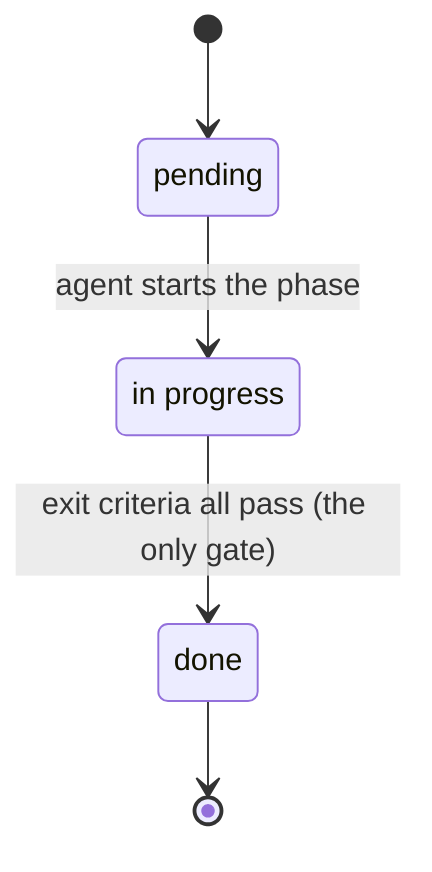

# Requirements — Modernization Harness

*What the harness is required to do, as currently implemented. Reverse-engineered from the stage
files, the two templates, and `DEVELOPER_GUIDE.md`.*

---

## 1. Purpose

The harness is a **prompt-based process** — not code — that lets one developer modernize a legacy
application with a coding agent, **one small testable increment at a time**, without losing
control of scope, quality, or history.

It ships as Markdown files the developer copies into their project and cites in prompts. No
runtime service to maintain: an optional installer copies the files into place, and one small
standard-library Python script (`tools/state.py`, DD-18) reads and writes `state.json`.

## 2. Users & actors

| Actor | Role |
|---|---|
| **Developer** | Drives the pipeline, merges, and is the *only* one who can record that something was tested |
| **Build agent** | Any LLM coding agent, running one stage per session |
| **Review agent** | The same, in a *separate* session, auditing what the build agent produced |

## 3. Scope

**In scope:** intake, requirements extraction, design, phased planning, incremental
implementation, and independent review — plus the state and paper trail that ties them together.

**Out of scope:** running the legacy app, executing data migration, deployment, load testing,
and anything that modifies the legacy source (read-only in every stage).

---

## 4. Functional requirements

### R1 — Stack-agnostic parameterization
- **R1.1** No source or target technology may be hardcoded in any stage file.
- **R1.2** All project-specific facts (stacks, CI/CD, cutover, repo layout, deployment topology)
  are captured **once**, in Stage 0, and read by every later stage.
- **R1.3** Project rules are expressed as **constraints with stable IDs** (`C1`, `C2`, …), each
  carrying **per-stage obligations**. Adding a constraint must require **no edit to any stage file**.
  The obligations are stored **once**, in `PROJECT_CONTEXT.md §4`; no second copy is kept in
  `state.json`.

### R2 — Load-bearing questions get decided, not guessed
- **R2.1** Intake asks 25 numbered questions, split into parts so that **each part asks one
  thing and takes one answer** (choices as tick boxes). Parts on **6 topics block the
  pipeline** (current stack, target stack, DB reuse, legacy coexistence, auth, cutover
  strategy), plus data migration when the target gets a new schema.
- **R2.2** A blank non-load-bearing answer gets a **stated default**; a blank load-bearing
  answer is a **hard stop**.
- **R2.3** Every answer the agent supplied on the developer's behalf must be reported back — in
  the Stage 0 hand-off report, and recorded with its provenance in `INTAKE_RESOLVED.md`.
- **R2.4** Inferred facts are marked `ASSUMPTION:`; unresolved ones `OPEN QUESTION:`.
- **R2.5** Answers that contradict each other are raised as an `OPEN QUESTION:`, never
  resolved by picking one — e.g. a side-by-side cutover on a shared database with no
  concurrent legacy writer.
- **R2.6** Intake gives each of these its own non-blocking part, so none has to be squeezed
  into another answer: how the target's API is described and tried by hand (5d–5e); the
  account each connection uses, **including the database** and inbound callers (10b); which
  group or claim grants each role (11f); how a developer signs in as each role to test (11g);
  how configuration and secrets reach the app (13f); and supplied specs, API descriptions, and
  request collections for the legacy app (18b). Accounts are recorded **by name, never by
  secret**, and a supplied document never overrides the legacy code — a disagreement is an
  `OPEN QUESTION:` or a note, by the trust the developer gives it.
- **R2.7** The answer-by-answer record of the resolved intake is **Stage 0's alone** — no later
  stage reads it. So every defaulted or inferred answer that shapes a later stage must also be
  stated in `PROJECT_CONTEXT.md` itself: in the section that owns that fact, as a constraint, or
  as an open question.

### R3 — Documents are produced in a fixed order

| Stage | Produces |
|---|---|
| 0 Context | `PROJECT_CONTEXT.md`, `INTAKE_RESOLVED.md`, `state.json` |
| 1 Requirements | Business / Functional / Technical requirements |
| 2 Design | HLD + LLD (the LLD is the authoritative contract) |
| 3 Plan | `PLAN_<App>.md` (remaining work only) + `state.json phases[]`; every later refresh |
| 4 Implement | Code, updated `FEATURE_STATUS.md` rows, and `HOW_TO_RUN.md` when running the app changed — plus a branch and a PR only where the agent runs git (R12) |
| 5 Review | `REVIEW_<Rid>_<App>_<target>.md` + findings in `state.json` |

- **R3.1** Every stage supports a **rerun with Additional Instructions**. Documents are amended
  in place with a Revision History row; git is the only version history.

### R4 — One gate, and a testing record
- **R4.1** The agent may set a phase `done` only when its **mechanical, falsifiable** exit
  criteria all pass. Subjective criteria ("looks correct") are forbidden. **This is the only
  gate in the pipeline.**
- **R4.2** Phase and edit status moves **forward only** — `pending` → `in progress` → `done`.
  Nothing rewinds; `done` is terminal. What is built is built.
- **R4.3** Whether a human has tested the work is recorded **per feature** in
  `FEATURE_STATUS.md`, never as a phase status, because a later phase can change what an
  earlier one delivered.
- **R4.4** Only the developer authorizes a `passed` or `failed` mark, and it **blocks nothing**.
  Several may be recorded at once when they name them. An agent may write `untested` — and must,
  for any row whose behavior it changed.

### R5 — Rolling plan
- **R5.1** The plan covers **remaining work only**; `done` phases drop to a Completed line,
  tested or not.
- **R5.2** **Stage 3 is the only stage that changes the forward plan.** Before each phase run,
  Stage 4 checks whether the remaining plan needs a refresh, **defaults to no change**, and — if
  a trigger applies that Stage 3 has not yet handled — stops and names it, having written
  nothing but the developer's notes. Triggers are change-log entries marked `For Stage 3:` —
  written by every requirements or design rerun, a context rerun that binds the plan, and Stage 4 — and a trigger is handled once a
  row of the plan's Revision History names its id.
- **R5.3** A re-slice is made only by a **Stage 3 run the developer starts**, never by Stage 4
  on its own. Stage 4 may still edit the **current** phase's tasks, test guide and exit criteria
  when reconciliation requires it.
- **R5.4** Phase IDs are **permanent** — never renumbered or reused. Execution order lives in
  the plan document, not in the IDs.
- **R5.5** **`FEATURE_STATUS.md`** holds one row per requirement, and rows are **never
  deleted** — the plan is a forecast, the ledger is the commitment.
- **R5.6** Work moved out of a phase by an approved mid-phase split is parked — recorded in
  `sizeReport.pushedLater` with no target phase, its ledger rows `unscheduled` — and the next
  Stage 3 refresh schedules it.

### R6 — Changes mid-build
- **R6.1** The agent classifies each request itself — **phase**, **contract change**, or **minor
  edit**. The test is *authority*, not size.
- **R6.2** A change touching a requirement, design contract, or plan scope is **not implemented
  that run**: the agent names the owning document, recommends the stage, logs it, and stops.
  The developer then reruns the owning stage, runs Stage 3 (refresh), and runs the next phase.
- **R6.3** `done` phases are **never reopened** for a design change. The fix is a new
  **retrofit phase**, sequenced before anything that would build on the old contract.
- **R6.4** Minor edits (`E-n`) get their own id, status, and review identity — and their own
  branch and PR where the agent runs git (R12) — and behave like phases throughout. They run
  from their own instruction file, started by the developer ("minor edit: …"); a phase run that
  receives one stops and asks for that run instead.

### R7 — Machine state
- **R7.1** `state.json` is the single source of truth for progress, lineage, and change history;
  Markdown holds content only.
- **R7.2** `changeLog[]` and `reviews[]` are **append-only**; corrections supersede. `edits[]`
  entries are never deleted or renumbered, but their lifecycle fields update in place, as
  `phases[]` entries' do (R6.4).
- **R7.3** A **high-water mark** (`lastProcessedChangeLogId`, `lastProcessedReviewNumber`, both
  integers) tells each run which entries it has already folded in.
- **R7.4** The developer never hand-edits `state.json` — they say what happened, the agent
  records it and confirms.
- **R7.5** Every `changeLog[]` entry records **who wrote it** — the developer, or the agent of
  the stage that wrote it — and **why** (a developer prompt, a stage rerun, reconciliation, an
  out-of-band change, or a review), from a fixed list. Every stage that writes an entry, reruns
  of Stages 0–3 included, has a value of its own to use.

### R8 — Independent review
- **R8.1** Review runs in a **separate session**; it never reviews code written in the same run.
- **R8.2** It covers requirement coverage, automated tests, security, and static performance.
- **R8.3** Findings are graded Blocker / Major / Minor. **Severities are information, never a
  gate** — a review blocks nothing, whatever it finds.
- **R8.4** Findings become `changeLog[]` entries the next Implement run reconciles and fixes;
  `progress.lastProcessedReviewNumber` tracks what has been dealt with. A review reports what
  is built vs. what was asked for, and what remains untested.
- **R8.5** Review is read-only on code, design, and requirements.

### R9 — Always-on governance
- **R9.1** `AGENTS.md` loads in **every** session, so the invariants apply to ordinary chat, not
  just formal stage runs.
- **R9.2** Out-of-band developer edits are logged to `changeLog[]` so the next run sees them.
- **R9.3** Conflicts resolve by a fixed ladder — **constraint → plan → LLD → HLD → requirements →
  context** — and a material conflict is *reported, never silently resolved*.

### R10 — Testability hand-off
- **R10.1** Every phase ends runnable and manually testable.
- **R10.2** Exactly **one** `HOW_TO_RUN.md` exists — how to build, run and configure the app —
  updated only when that actually changes, and its commands run by the agent at hand-off.
- **R10.3** Per-feature checks live in `FEATURE_STATUS.md`, beside the tested column. Changed
  behavior edits its check **in place** and resets the row to `untested` — no check may describe
  something that no longer works, and no `passed` mark may outlive the behavior it vouched for.
- **R10.4** Every hand-off report carries **two counts** — features awaiting testing, and open
  review findings — plus the rows this phase put at risk.

### R11 — Git discipline
*All of R11 applies only where the agent runs git (`context.repo.git` is `agent`, R12).*

- **R11.1** Branch per unit of work, small self-describing commits, a PR whose body records
  initial task / reasoning / outcome.
- **R11.2** The agent branches from **the currently checked-out branch** and targets its PR at
  it. **It never merges.** Nothing in the pipeline depends on a merge, because the next phase
  starts from where the previous phase's code already is; merging is the developer's housekeeping
  alone. `context.repo.prTarget` records intent and **no rule reads it**.
- **R11.3** Presence of work is checked **by content**, never by branch-merge status: git is the
  truth and `state.json` is a cache. No merge is recorded anywhere. Work merged or edited outside
  the harness is detected, not reported by the developer.
- **R11.4** Where the developer asks for the change **on the current branch**, the agent creates
  no branch and opens no PR; `prUrls` stays empty and the PR body's history moves into the commit
  messages. Under a `split` layout this applies per repo.
- **R11.5** Before branching, the agent checks whether the current branch is **already merged or
  deleted on the remote** — the normal state after the developer merges on the host — and proposes
  the branch it was merged into rather than building on a spent branch.
- **R11.6** The agent merges **only** on an explicit instruction naming the item. It never merges
  unasked and never asks for a merge, since nothing depends on one.

### R12 — Git mode
- **R12.1** Who runs git is decided once, in Stage 0, from the intake, and recorded as
  `context.repo.git`: `agent` or `developer`. The default is `agent`, and a missing setting
  (a project set up before it existed) also means `agent`.
- **R12.2** Under `agent`, R11 applies. Its rules live in a separate file that Stage 4 loads
  only in this mode, so a project that does not use them does not pay for them.
- **R12.3** Under `developer`, the agent runs **no git command that changes the repository** —
  no branch, checkout, commit, push, merge, or PR. Read-only commands (`status`, `diff`, `log`,
  `show`) are allowed. `branch` stays `null` and `prUrls` empty.
- **R12.4** Under `developer`, every hand-off lists the changed files and a suggested commit
  message, and the changed files are recorded in the phase's or edit's `notes`. The developer
  commits after each run, before the next.
- **R12.5** Under `developer`, the predecessor's work is checked by content — its files and
  symbols exist in the working tree — exactly as R11.3 checks it under `agent`.

---

## 5. Quality requirements

| # | Requirement |
|---|---|
| Q1 | **Readable in five minutes** — `README.md` gets a developer running; `DEVELOPER_GUIDE.md` carries the reasoning; `USE_CASES.md` walks the situations by example |
| Q2 | **No duplicated rules** — a constraint-specific rule lives in its obligation, once |
| Q3 | **Falsifiability** — every gate the agent self-checks is objectively checkable |
| Q4 | **Low prompt cost** — steady state is one prompt per phase; a mid-build design change costs exactly two extra (rerun the owning stage, then a Stage 3 refresh) |
| Q5 | **Auditability** — every state change traces to a `changeLog[]` entry and a git commit (under `developer` git mode, the developer's commit) |

## 6. Invariants (never violated, in any stage or ad-hoc chat)

1. Legacy source is **read-only**.
2. `INTAKE.md` and the `*_TEMPLATE.md` files are **inputs, never written to**.
3. `changeLog[]` and `reviews[]` are **append-only**.
4. Phase and edit status moves **forward only** — `pending` → `in progress` → `done`; `done` is
   terminal (R4.2).
5. Only the developer authorizes a `passed`/`failed` mark — and it gates nothing.
6. The agent **never merges unless the developer asks**, in those words — and under `developer`
   git mode, never at all (R11.6, R12.3).
7. **No secrets** in code, docs, state, commit messages, or PR bodies.
8. Never mutate a reused database's schema — fix the mapping instead.

---

## 7. The lifecycle every phase must follow

*Forward only. `done` is terminal — a failure the developer reports, or a design change that
invalidates the work, becomes new forward work, never a reopened phase. Whether a human has
tested it is tracked separately, per feature, in `FEATURE_STATUS.md`.*
